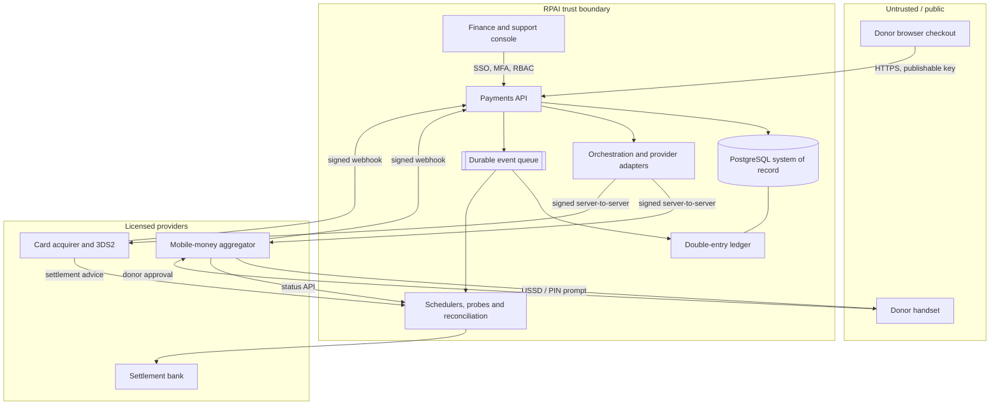
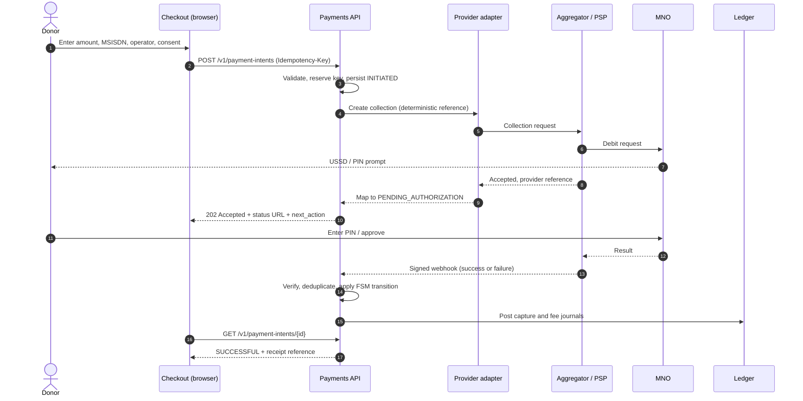
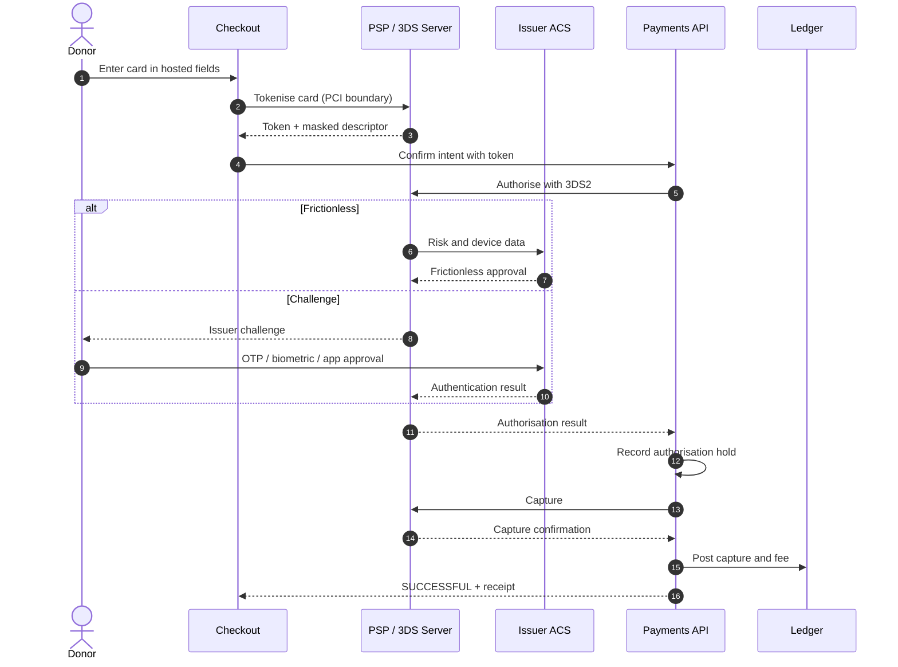
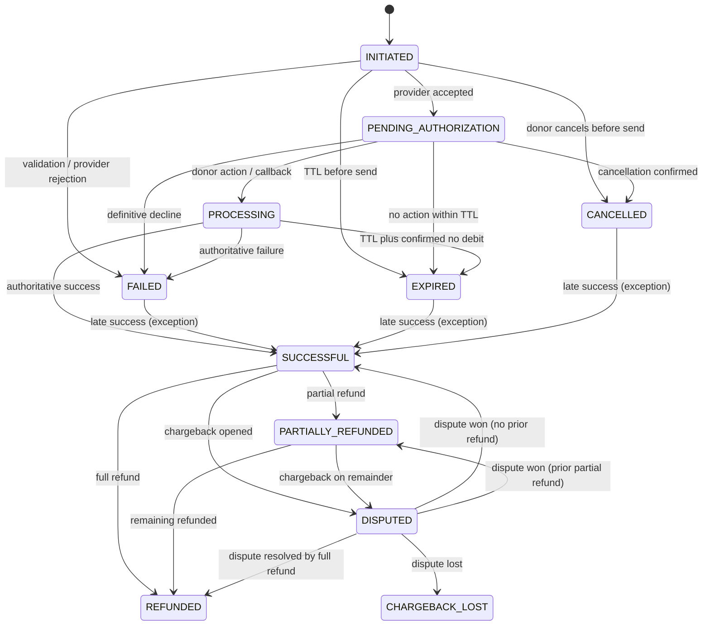
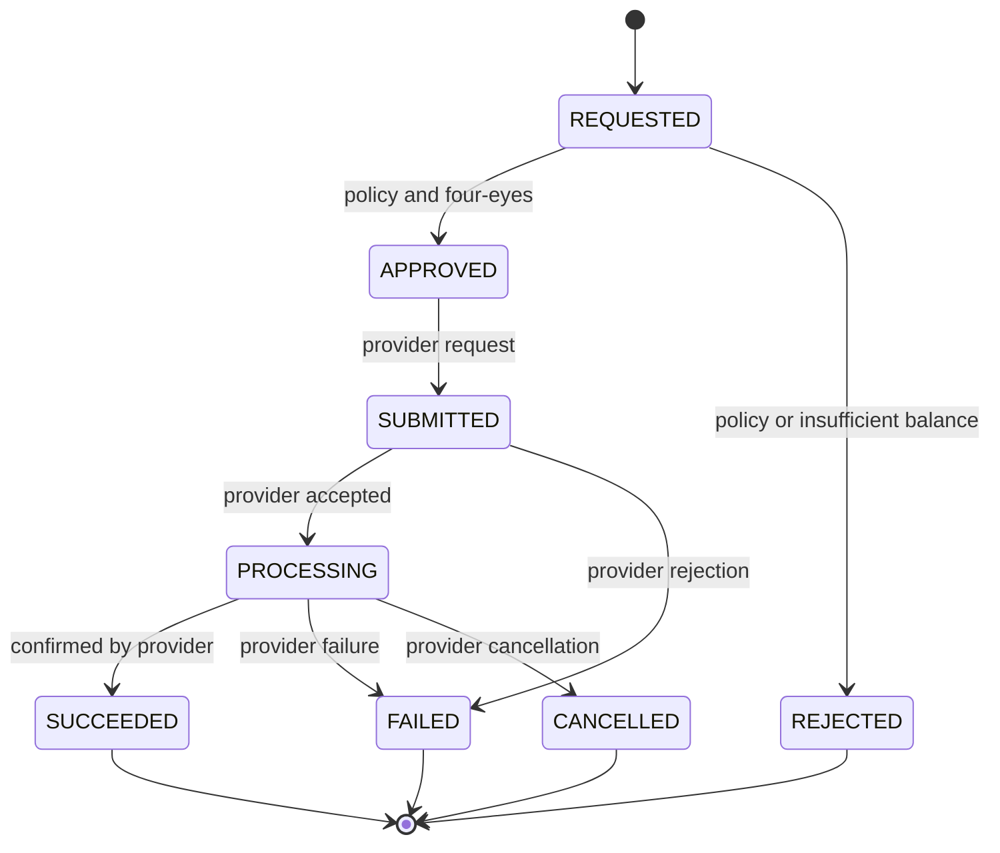
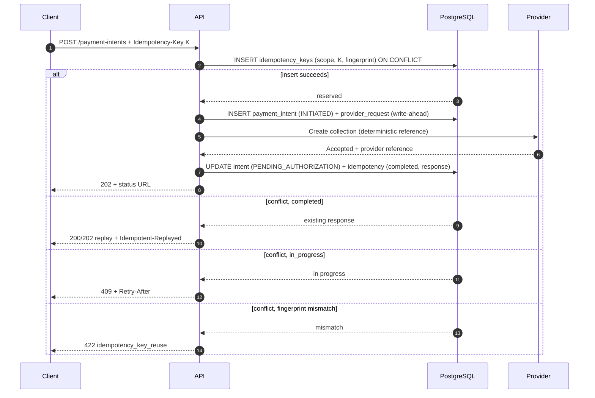
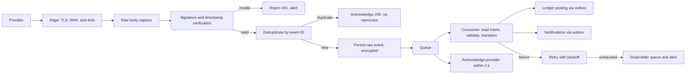
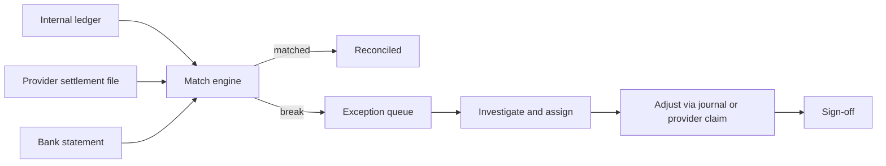
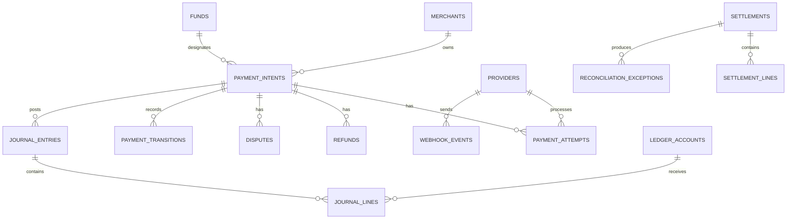

# Unified Payment Gateway & Financial Architecture Specification

**Royal Priesthood Assemblies International — Giving Platform**

| Field | Value |
|---|---|
| Document status | Draft for architecture and trustee review |
| Version | 1.1 |
| Date | 22 October 2026 |
| Owner | Principal Financial Systems Architect |
| Audience | Trustees, finance team, engineering, security reviewers, PSP partners |
| Scope | Mobile money collections (Airtel Money, MTN Mobile Money, Zamtel Kwacha), card payments (Visa, Mastercard, 3-D Secure v2), refunds, disputes, settlement, reconciliation, ledger, security governance |
| Out of scope | Executable implementation, vendor contract negotiation, legal or tax advice |
| Classification | Internal — contains financial control design |

**Revision 1.1 — review fixes.** This revision corrects the intent/attempt retry model, removes the create/confirm ambiguity, adds card authorisation/capture and bank-transfer resolution semantics, formalises refund and dispute sub-lifecycles, and adds a threat model, requirements/assumptions register, reconciliation line schema, current-to-target migration map, acceptance-test catalogue, receipt/accessibility requirements and a provider scoring rubric. A plain-language companion is at `docs/payments/EXECUTIVE-BRIEF.md`.

**How to read this document.**

| Reader | Recommended path |
|---|---|
| Trustees and finance | Executive brief, §0, §6.3, §9.8, §10 |
| Engineering | §2–§5, §7–§8, Appendices E–F |
| Security and compliance | §7, §7.9, Appendix E |
| Provider evaluation | §2.1, §2.2, Appendix C |
| Donor support | §2.2.4, §5.5, §5.11, §5.12 |

> **A note on the brief.** The supplied instruction ended mid-heading at “SECTION 3: ASYNCH”. This document completes that section as **Asynchronous Eventing, Webhook Integrity and Settlement Reconciliation**. For traceability: the brief’s Section 1 is covered in §2, its Section 2 in §3, and its truncated Section 3 in §4. Sections 0–1 and 5–11 add current-state context and the production controls required by the mandate. The required state name `INITUATED` is treated as the canonical `INITIATED`.
>
> **A note on code.** This is a specification, not an implementation. The JSON fragments are illustrative API contracts, not executable code. Mermaid diagrams are declarative models. No implementation, infrastructure or migration is authorised by this document alone.

---

## Contents

0. [Executive decision summary](#0-executive-decision-summary)
1. [Current-state assessment](#1-current-state-assessment)
2. [System requirements and integration modelling](#2-system-requirements-and-integration-modelling)
3. [Transaction state machine and idempotency architecture](#3-transaction-state-machine-and-idempotency-architecture)
4. [Asynchronous eventing, webhooks and reconciliation](#4-asynchronous-eventing-webhooks-and-reconciliation)
5. [API contract design](#5-api-contract-design)
6. [Data architecture and financial ledger](#6-data-architecture-and-financial-ledger)
7. [Security and compliance governance](#7-security-and-compliance-governance)
8. [Reliability, observability and operations](#8-reliability-observability-and-operations)
9. [Delivery roadmap and acceptance gates](#9-delivery-roadmap-and-acceptance-gates)
10. [Open decisions](#10-open-decisions)
11. [Appendices](#11-appendices)

---

## 0. Executive decision summary

The platform should be built as a **provider-agnostic payment orchestration layer with a double-entry ledger**, not as a thin wrapper around one payment gateway.

The nine decisions that follow from the analysis are:

1. **Aggregator-first, not direct-to-MNO.** At RPAI’s expected volume, direct integrations with Airtel, MTN and Zamtel would add three contracts, three security reviews, three reconciliation formats and three support relationships for a marginal per-transaction saving. Use a licensed aggregator, keep a second provider warm, and revisit direct MNO integration only when volume and cost data justify it.
2. **Separate the mobile-money rail from the card rail when necessary.** No single provider may prove, in sandbox, that it can do true server-initiated USSD collection on all three Zambian operators, first-class Visa/Mastercard 3DS2 acquiring, ZMW settlement, signed webhooks and reliable refunds. The adapter layer must allow the mobile-money rail and the card rail to be supplied by different providers without changing the checkout contract.
3. **A provider’s “accepted” response is not a payment.** Only a verified webhook, a verified status response, or a settlement report can move an intent to `SUCCESSFUL`. Timeout is not failure. Ambiguity is a first-class state, not an error to be guessed away.
4. **Every money-moving request is idempotent by construction.** `Idempotency-Key` is mandatory on intent creation and refunds, bound to a request fingerprint, stored in the database, and replayed with the original response. Provider references are deterministic and never regenerated on retry.
5. **PostgreSQL is the system of record; Redis is coordination only.** Redis locks cannot be the authority for balances. Balance mutation uses database row locks, serialisable transactions and append-only journal entries. Redis may accelerate locks and rate limits but never owns financial truth.
6. **Webhooks are the primary confirmation path; polling and settlement files are independent second and third confirmations.** The three are reconciled. No single channel is trusted blindly.
7. **The ledger is double-entry and append-only.** A payment status is an operational fact; the ledger is the financial fact. Every capture, fee, refund, chargeback, settlement and manual correction produces a balanced journal. Corrections are reversals, never edits.
8. **Card data never enters RPAI systems.** Hosted fields or redirect keep the church in PCI DSS SAQ A scope. 3DS2 is mandatory where the issuer supports it. No PAN, CVV or PIN is logged, stored or transmitted by RPAI infrastructure.
9. **Go-live is evidence-gated.** A provider is not “supported” because its website says so. It is supported when sandbox and contract evidence passes the gates in §2.1.6, and when reconciliation, refund and failure drills have passed.

**The most important current finding:** the existing Paystack integration on the Give page is a **redirect-to-authorisation-page** flow, not a server-initiated USSD push. The code itself documents this. The Lenco review in `GIVING-PLAN.md` reached a similar conclusion from the other direction: Lenco’s public API supports virtual accounts and disbursements, not a phone prompt. Neither should be described to donors as “we will send a prompt to your phone” until a provider has demonstrated that behaviour in production-like conditions.

---

## 1. Current-state assessment

This section records what exists in the repository at the time of writing, so the target architecture is grounded in the actual system rather than an imaginary greenfield.

### 1.1 What exists today

| Area | Current implementation | Consequence |
|---|---|---|
| Runtime | Node.js/Express API in `server/`, static site elsewhere | Sound separation of secret-bearing server from public HTML |
| Mobile money | `POST /api/charge` calls Paystack `/charge` with `channels: ['mobile_money']`; returns an `authorization_url` | Donor is redirected to a secure page to enter a PIN. This is **not** an asynchronous USSD push initiated by the server |
| Card | No card path | Visa/Mastercard cannot be accepted; no 3DS2 |
| Bank transfer | Returns static instructions and an unpersisted “intent” object | No record survives the request; reconciliation is manual |
| Operators | Validation accepts only `mtn` and `airtel` | Zamtel Kwacha is not supported |
| Donor data | Email is mandatory for every mobile-money charge; no SMS receipt path | Excludes donors without email and adds unnecessary friction |
| Country restriction | `ALLOWED_COUNTRIES` is configured but not referenced in the request path | The stated country control is not actually enforced |
| Persistence | In-memory `Map` for payments and idempotency | All state is lost on restart or deploy; unsafe across multiple instances |
| Idempotency | Optional `Idempotency-Key`, in-memory, 15-minute TTL, no request fingerprint | Double taps across instances can create duplicate charges; key reuse with a different amount is not detected |
| Webhooks | HMAC-SHA512 over raw body, constant-time compare | Good cryptographic baseline |
| Webhook processing | Parses `charge.success` / `charge.failed`, updates status unconditionally | No event deduplication; a late `charge.failed` can overwrite a prior success; no state-machine guard |
| State model | Raw provider status strings (`pending`, `success`, etc.) | No canonical lifecycle; ambiguous provider states are not modelled |
| Refunds | None | Refunds are manual and untracked; no ledger impact |
| Disputes | None | Chargebacks are invisible to the platform |
| Expiry | None | Stale `pending` records persist indefinitely |
| Reconciliation | None | No settlement ingestion or three-way match |
| Ledger | None | No fund accounting, fee accounting, clearing balance or audit trail |
| Rate limiting | In-memory, per-instance | Not effective behind multiple instances |
| Observability | `console.log` | No metrics, traces, alerting or reconciliation dashboard |
| Secrets | `.env` locally; example file is correctly placeholder-only | Must be moved to a managed secret store and excluded from git |
| Provider abstraction | Direct `paystack.js` module | Provider lock-in; adding a second rail requires edits across routes |
| Currency handling | A hard-coded exponent map treats ZMW as exponent 0 | ISO 4217 lists ZMW with two decimal places, while some PSPs use whole units; the provider contract must decide, and a 100× error is possible if the assumption is wrong |

### 1.2 Material risks in the current design

1. **Double-debit risk.** A donor taps “Give” twice, two API instances each miss the in-memory idempotency record, and two collections are initiated.
2. **False failure risk.** A network timeout is returned to the browser while the MNO has already debited the donor. The donor retries and is debited twice.
3. **State regression risk.** A delayed `charge.failed` webhook can overwrite a `charge.success` state because no transition guard exists.
4. **Lost-state risk.** A restart during a pending payment erases the record; the donor has no way to obtain a receipt, and finance cannot reconcile.
5. **No financial truth.** A status field is not a ledger. There is no record of fees, settlement, fund designation or the difference between “paid” and “received in the bank”.
6. **Channel mismatch.** The Give page’s language and the actual Paystack redirect flow must be aligned before launch. A donor told to “enter your PIN on your phone” who is instead sent to a web page will abandon or distrust the flow.
7. **Currency exponent risk.** ZMW is listed by ISO 4217 with two decimal places, but the current code hard-codes exponent 0. If the chosen provider expects minor units, a ZMW 250 gift could be sent as ZMW 2.50 or ZMW 25,000. This must be proven in sandbox before any live payment and enforced by a single, provider-aware money type.

### 1.3 Target state in one paragraph

A donor chooses Mobile Money, Card or Bank Transfer in one checkout. The API creates a `payment_intent` with a mandatory idempotency key. For mobile money, an adapter sends a collection request to a licensed aggregator, which triggers a USSD prompt on the donor’s handset; the API returns `PENDING_AUTHORIZATION` immediately and the browser polls a status endpoint. For cards, the browser tokenises card data inside the provider’s hosted fields, completes 3DS2 if challenged, and the API authorises and captures. Every provider event is signature-verified, deduplicated, ordered and applied through a formal state machine. Every financial effect is posted to a double-entry ledger. Settlement reports and bank statements are reconciled to the ledger daily. Refunds and disputes are first-class objects. The donor sees a truthful status at all times, and finance can prove every kwacha from donor intent to bank credit.

---

## 2. System requirements and integration modelling

### 2.1 Aggregation versus direct MNO integration

#### 2.1.1 The two models

**Direct point-to-point MNO integration.** RPAI contracts separately with Airtel, MTN and Zamtel (or their payment gateway arms), integrates each collection API, handles each operator’s authentication, retries, callback format, settlement file and support escalation.

**Unified PSP aggregator.** RPAI contracts with one licensed provider that abstracts the three MNOs and, ideally, card acquiring. RPAI integrates one API and receives one settlement report, while the aggregator maintains the operator connections.

#### 2.1.2 Trade-off analysis

| Dimension | Direct to MNOs | Aggregator | Implication for RPAI |
|---|---|---|---|
| Integration effort | Three APIs, three auth schemes, three callback contracts, three test regimes | One API, one sandbox, one contract | Aggregator wins decisively at current scale |
| Time to market | Months, including commercial onboarding with each operator | Weeks, subject to KYC | Aggregator |
| Per-transaction cost | Usually lower headline fee at volume; minimums and integration costs may apply | Higher headline fee; includes abstraction and support | Direct only wins above a volume threshold |
| Latency | One fewer network hop, but MNO gateway and USSD human latency dominate | One additional hop, typically tens to hundreds of milliseconds | Not a decisive factor: the donor’s PIN entry takes seconds to minutes |
| Settlement | Separate settlement cycles, accounts and statements per operator | Consolidated settlement, one reconciliation file | Aggregator substantially reduces finance overhead |
| Reconciliation | Three reference formats, three cut-off times, three exception queues | One format, one cut-off, one exception queue | Aggregator |
| Coverage | Full control of each operator relationship | Depends on aggregator’s live coverage and commercial terms | Must be proven per operator, not assumed |
| Uptime and failover | Outage in one operator does not affect the others; RPAI owns failover | Aggregator outage affects all rails; a second provider is needed | Aggregator requires a second provider, not a second MNO |
| Control | Direct influence on routing, retries, limits, new features | Constrained by aggregator roadmap and API | Direct wins for bespoke needs |
| Compliance and PCI | RPAI carries more integration and audit burden; card acquiring still separate | Aggregator carries licensing, PCI and much of the compliance surface | Aggregator reduces regulatory and security burden |
| Working capital | May require pre-funding or settlement reserves per operator | One reserve and one settlement cycle | Aggregator simpler |
| Vendor risk | Diversified across operators but operationally fragmented | Concentrated in one provider | Mitigate with an adapter and a qualified secondary provider |
| Multi-currency | MNO rails are domestic (ZMW); cards remain separate | Some aggregators combine ZMW mobile money and USD card acquiring | Aggregator can simplify the donor experience but introduces FX complexity |

#### 2.1.3 Cost model

The correct comparison is not “headline fee versus headline fee”. It is total cost of ownership:

> **Total cost = provider fees + FX spread + settlement float + reconciliation labour + integration and maintenance + failure cost (duplicate debits, missed receipts, chargebacks, donor trust) + compliance cost.**

A direct integration that saves one percentage point of fee but consumes two engineering months per year, one finance day per week and a reserve account per operator is usually more expensive for a church than an aggregator. The break-even calculation must include staff time and the cost of a single duplicate-debit incident.

As an illustrative only calculation: at ZMW 1,000,000 monthly volume, a one-percentage-point aggregator premium is ZMW 10,000 per month, or ZMW 120,000 per year. A direct integration with ZMW 150,000 of initial engineering and ZMW 60,000 per year of ongoing operational cost saves ZMW 60,000 in the first year, so it takes about 30 months to recover the initial build plus the first year of operation — **before** counting failure risk and compliance. At RPAI’s likely volume, that payback is not attractive. Revisit the calculation annually with real data.

#### 2.1.4 Latency reality

The donor experience is dominated by human and radio-network time:

| Stage | Typical duration | Who controls it |
|---|---|---|
| API validation and intent creation | 50–300 ms | RPAI |
| Aggregator acceptance | 200 ms–2 s | Aggregator |
| MNO processing and USSD prompt delivery | 1–15 s | MNO |
| Donor notices prompt and enters PIN | 10–120 s | Donor |
| MNO result and callback | 1–30 s | MNO |
| Webhook delivery and processing | < 5 s | Aggregator and RPAI |

An extra aggregator hop is noise compared with a two-minute PIN entry. **Do not choose a direct integration on latency grounds at this scale.** Choose on coverage, reliability, reconciliation and total cost.

#### 2.1.5 Recommended integration model

**Recommendation: aggregator-first, dual-rail, adapter-based.**

- **Rail A — Mobile money collections.** One primary aggregator that demonstrably supports server-initiated USSD collection for Airtel, MTN and Zamtel in ZMW. One qualified secondary provider held in standby, with the same adapter contract, for failover and negotiating leverage.
- **Rail B — Card acquiring.** A provider with Visa/Mastercard acquiring, EMV 3DS2, tokenisation, ZMW or USD pricing, and Zambian settlement. This may be the same aggregator as Rail A if it passes the gates; if not, it is a separate adapter.
- **No cross-rail retry after authorisation.** A payment authorised on Rail A must never be re-attempted on Rail B as if it were a fresh payment. A new attempt is a new intent with its own idempotency key and a clear donor action.
- **Direct MNO integration is a later option, not a starting point.** Revisit only when all of the following hold: sustained volume above an agreed threshold; direct pricing saves a material share of total cost; RPAI has the engineering and finance capacity to operate three integrations; and the aggregator’s reliability or commercial terms have become unacceptable.

**Logical architecture and trust boundaries.**



The boundaries matter: the browser and the handset are untrusted; provider callbacks are untrusted until the signature is verified; the finance console is a privileged boundary requiring SSO, MFA and role checks; the database and ledger are private and reachable only from the application network. The queue is durable because losing an event is losing a financial fact.

The adapter contract is the key maintainability device. Every provider is reduced to the same conceptual capabilities:

| Capability | Contract expectation |
|---|---|
| Capability discovery | Report supported operators, currencies, payment methods, amount limits, 3DS support and settlement currencies |
| Create collection | Accept a deterministic merchant reference, amount, currency, MSISDN, operator and callback URL; return accepted/rejected and a provider reference |
| Retrieve status | Return a normalised status for a provider reference, with amount, currency and timestamps |
| Cancel | Cancel before authorisation where the provider supports it; otherwise return a precise “not cancellable” reason |
| Refund | Full or partial refund against a captured payment, with its own reference and status |
| Verify webhook | Verify the provider’s signature over the raw body and return a normalised event |
| Settlement report | Retrieve or receive a machine-readable settlement file with gross, fees, refunds, chargebacks and net |
| Health | Report availability and rate-limit state without moving money |

#### 2.1.6 Provider selection gates

A provider is eligible for production only when **all** hard gates are evidenced in a sandbox and in the contract:

1. **Legal and regulatory.** Contracted entity, licence or sponsor arrangement, and written confirmation that RPAI’s use case (charitable donations) is permitted.
2. **True push collection.** A server-to-server request triggers a USSD prompt on an Airtel, MTN and Zamtel handset without the donor leaving the church checkout. A hosted redirect page is not equivalent.
3. **ZMW collections.** ZMW is supported as a collection currency, with documented amount precision. A provider that only settles USD but displays ZMW is a different risk and must be treated as FX.
4. **Signed webhooks.** A documented signature scheme, timestamp or replay protection, and a stable event identifier.
5. **Status API.** An authoritative status query that distinguishes pending, successful, failed, cancelled and unknown.
6. **Refunds and reversals.** Documented refund path for mobile money and cards, with time limits and fee treatment.
7. **Cards and 3DS2.** Visa and Mastercard, EMV 3DS2 frictionless and challenge flows, tokenisation, and clear liability-shift rules.
8. **Settlement.** Settlement to a Zambian bank account, with a machine-readable advice and a defined cut-off and value date.
9. **Reconciliation.** Stable provider references, settlement file access, and support for matching by merchant reference.
10. **Security and data protection.** PCI DSS attestation, encryption, incident notification, data-processing terms and sub-processor disclosure.
11. **Operational support.** Named escalation contact, published status page, incident history and a response-time commitment.
12. **Commercial clarity.** All fees, FX spreads, reserves, minimums, chargeback fees and termination terms in writing.

#### 2.1.7 Shortlist analysis

Inclusion below is not an endorsement. Publicly documented positioning changes; every row must be replaced by sandbox evidence before a contract is signed.

| Provider | Model | Apparent strengths | What must be proven | Possible role |
|---|---|---|---|---|
| **Flutterwave** | Pan-African aggregator; cards and mobile money | Broad coverage, single API, card acquiring, developer tooling | ZMW collection and true USSD push for all three Zambian operators; 3DS2; settlement to Zambia; refunds; reconciliation file quality | Candidate for combined rail if it passes all gates |
| **DPO Pay** | Pan-African PSP; cards and mobile money | Established enterprise processing, card acquiring, African coverage | Whether its Zambian mobile-money product is a true push or a redirect; 3DS2; ZMW precision; settlement reporting | Candidate for card rail, or combined rail |
| **Pawapay** | Mobile-money specialist; collections and payouts | Deep MNO abstraction, API-first design, strong fit for Airtel/MTN/Zamtel collections | Card acquiring (likely not core); ZMW settlement; refunds; dispute handling; commercial terms | Strong candidate for Rail A, paired with a card acquirer |
| **Kazang** | Zambian payments and agent network | Local presence, bill payments, merchant network | Online API maturity, true push collections, card acquiring, 3DS2, webhook and settlement reporting | Local fallback or complementary channel; verify |
| **Lipila** | Zambian fintech; collections and disbursements | Local API-first positioning, mobile-money focus | Licence and sponsor status, scale, card capability, 3DS2, settlement guarantees, disaster recovery | Local candidate for Rail A; concentration risk must be assessed |
| **Paystack** | Nigerian-origin aggregator; cards and mobile money | Excellent developer experience and documentation | Zambian/ZMW support, true USSD push, 3DS2, local settlement; the current integration is redirect-based | Keep as a qualified secondary only if the gates pass |
| **Lenco** | Zambian business banking and payments | Virtual accounts and disbursements; local bank rails | No public collection/PIN-prompt endpoint per the project’s own review; card acquiring absent | Virtual-account/bank-transfer channel, not a USSD rail |

**Shortlist recommendation for the sandbox phase:** DPO Pay and Flutterwave for the combined-rail test; Pawapay for the dedicated mobile-money test; Lipila and Kazang for local resilience and pricing comparison. Do not sign an exclusive contract before the sandbox results are compared on the same scorecard.

#### 2.1.8 Weighted decision scorecard

Use the following weights for the final selection. Scores must be justified by evidence, not sales material.

| Criterion | Weight | Evidence required |
|---|---:|---|
| Mobile-money coverage and true push | 20 | Successful test on Airtel, MTN and Zamtel handsets |
| Card acquiring and 3DS2 | 15 | Frictionless and challenge tests, liability-shift documentation |
| Reconciliation and settlement reporting | 15 | Sample settlement file, reference matching, cut-off and value date |
| Maintainability and API quality | 15 | Sandbox ergonomics, error semantics, webhook replay, documentation |
| Cost at expected volume | 10 | Full fee schedule, FX spread, reserves, refund and chargeback fees |
| Latency and uptime | 10 | Status page history, SLA, measured sandbox latency |
| Local support and regulatory standing | 10 | Licence, named support, incident process, Zambian references |
| Refunds, reversals and disputes | 5 | End-to-end test and fee treatment |

**Scoring anchors (1–5).** A score without an evidence reference is invalid.

| Score | Meaning |
|---:|---|
| 1 | Fails a hard gate, or no evidence supplied |
| 2 | Documented but unproven; material caveats |
| 3 | Sandbox works with caveats; contract or coverage still unclear |
| 4 | All sandbox tests pass; contract and settlement terms acceptable |
| 5 | Production evidence, SLA, local references and contract proven |

**Decision rule:** any hard-gate failure in §2.1.6 disqualifies the provider. Otherwise select the highest weighted score, require at least two qualified providers for the mobile-money rail, and record the evidence reference for every score. Do not average away a failed gate.

#### 2.1.9 Multi-currency clearing mechanics

Three different currencies may be involved in one donation:

1. **Currency of record** — the currency in which the donor’s intent is denominated (normally ZMW for mobile money; ZMW or USD for cards).
2. **Currency of authorisation** — the currency the card network or MNO authorises.
3. **Currency of settlement** — the currency credited to RPAI’s bank account.

The platform must store all three, plus the FX rate and its source, rather than collapsing them into one number. Rules:

- **Never use floating point for money.** Store integer minor units plus a currency exponent from a controlled registry.
- **Do not assume ZMW precision from ISO 4217 or from an existing code constant.** ISO 4217 lists ZMW with two decimal places, while some PSPs treat it as whole units. The provider contract and sandbox must determine the exponent; a mismatch of 100× is a catastrophic error. The existing code’s exponent-0 assumption must be verified against the chosen provider, not carried forward as a global truth.
- **Display and charge the same amount.** If the card is authorised in USD, the donor must see the USD amount and the applicable conversion before confirming.
- **Separate FX gain/loss.** If settlement currency differs from currency of record, post the difference to an FX gain/loss account; never silently adjust the donation amount.
- **Disclose fees.** If the donor is asked to cover fees, model that as a separate line, not by inflating the donation amount invisibly.
- **Rounding.** Define the rounding policy per currency and per fee calculation; retain the unrounded calculation in the audit record.

### 2.2 Channel support and payment method protocols

#### 2.2.1 Unified checkout model

The checkout exposes one interface with three method families:

| Method family | Donor action | Confirmation path | Typical finality |
|---|---|---|---|
| Mobile money — push collection | Enter MSISDN, confirm operator, approve USSD prompt with PIN | Signed webhook plus status probe | Seconds to minutes; settlement T+1 or T+2 |
| Card — 3DS2 | Enter card in hosted fields; complete challenge if requested | Authorisation response, then capture; signed webhook; settlement advice | Seconds for authorisation; settlement T+1 to T+3 |
| Bank transfer / virtual account | Receive account details and a unique reference; pay from banking app | Bank credit matched to reference; virtual-account webhook if available | Minutes to one business day; manual exception handling possible |

The API must not expose provider-specific method names to the browser. The browser sees a normalised method (`mobile_money`, `card`, `bank_transfer`) and a `next_action` object. The adapter translates.

#### 2.2.2 Channel A — Push-to-mobile-money collection

**Definition.** The donor initiates a collection on the church’s checkout. The server sends an asynchronous collection request to the aggregator or MNO. The MNO delivers a USSD session or PIN prompt to the donor’s handset. The donor approves or declines. The result arrives as a signed callback and is independently confirmed by a status query.

**Preconditions:**

- The MSISDN is valid, normalised to E.164 (`+260…`), and belongs to a supported operator.
- The operator is detected from the prefix and confirmed by the donor; number portability means prefix detection is a hint, not proof.
- The amount is within the operator’s and the provider’s minimum and maximum limits, and within RPAI’s own risk limits.
- The donor has consented to receive a payment prompt and understands that the prompt is the authorisation step.
- The provider has confirmed that the operator’s collection service is available.
- An idempotency key has been reserved and a payment intent persisted **before** the outbound request.

**Sequence:**



**Command execution model.** The API persists the intent and the provider command before returning. If the provider call completes within the request budget, the response can be `PENDING_AUTHORIZATION` with `next_action: ussd_prompt`. If it does not, the API returns `202` with `PROCESSING/AWAITING_PROVIDER` and a `poll` action, and a worker executes the call from the durable outbox. Both paths use the same idempotency key and deterministic provider reference; the state machine does not care which path was taken. The diagram shows the direct path for readability.

**Timing and donor experience:**

- The API returns within a defined budget: p95 under 800 ms for persistence and queuing, and p95 under 3 s for provider acceptance. It does **not** wait for the donor’s PIN.
- The browser shows an explicit “Check your phone” state with the masked MSISDN, the operator, the amount, a countdown and a “I did not receive a prompt” action.
- “I did not receive a prompt” must **not** blindly resend a debit. It first queries the provider for the current session. A resend is permitted only when the provider confirms that no session exists and therefore the original request had no financial effect; in that case the platform creates a **new attempt** under the same intent, with a new attempt number and a rate limit.
- Polling is a user-interface convenience. The webhook is the authoritative confirmation. The status endpoint may itself trigger a provider status query when the local state is non-terminal and older than a threshold.
- On success, show the amount, currency, reference, timestamp and receipt download. On failure, show a plain-language reason and safe alternatives. On ambiguity, say “We are still confirming this payment” and never “Failed” until failure is proven.

**Operator-specific mechanics:**

| Operator | Prompt style | Typical donor interaction | Notes for the adapter |
|---|---|---|---|
| Airtel Money | USSD prompt / PIN entry | Donor enters PIN on handset | Confirm prompt language and session timeout per operator |
| MTN Mobile Money | USSD prompt / PIN entry | Donor approves and enters PIN | Confirm approval semantics and declined-prompt behaviour |
| Zamtel Kwacha | USSD prompt / PIN entry | Donor approves and enters PIN | Must be explicitly tested; current validation excludes it |

> The precise USSD strings, menu paths and timeout values are operator- and provider-version-specific. They belong in the adapter’s configuration and test fixtures, not in hard-coded assumptions in the checkout.

**Failure semantics that must be handled:**

- Donor does not receive the prompt (network, handset, SIM session).
- Donor enters the wrong PIN and exhausts attempts.
- Donor declines the prompt.
- Insufficient funds or wallet limit exceeded.
- Operator session timeout while the debit may still have succeeded.
- Provider accepts the request but never sends a callback.
- Duplicate callback.
- Late success after the UI has shown “expired”.
- MSISDN is ported to a different operator.
- Amount exceeds the operator’s daily or per-transaction limit.
- The wallet is barred, frozen or not KYC-verified.

#### 2.2.3 Channel B — 3-D Secure v2 card processing

**Definition.** The donor enters card details in a PCI-scoped hosted field or is redirected to the provider’s payment page. The provider tokenises the card and runs EMV 3DS2. Depending on the issuer’s risk decision, the flow is frictionless or requires a challenge. On successful authentication, the provider authorises the payment; RPAI captures it (automatically for donations, or manually for exceptional high-value cases) and later reconciles settlement.

**Actors:**

- **Cardholder** — the donor.
- **Merchant** — RPAI.
- **PSP / acquirer** — the provider that holds the merchant account and connects to the card networks.
- **3DS Server / MPI** — the component that performs 3DS2 message exchange (usually the PSP).
- **Directory Server** — Visa Secure or Mastercard Identity Check.
- **Access Control Server (ACS)** — the issuer’s authentication service.
- **Issuer** — the donor’s bank.

**Phases:**

1. **Enrolment and device fingerprinting.** The 3DS Server checks whether the card is enrolled and may run the 3DS Method to collect device data. This happens before or alongside authorisation and is invisible to the donor.
2. **Risk-based authentication.** The issuer decides frictionless approval or challenge. Frictionless is not “no security”; it is a risk decision based on device, transaction and issuer data.
3. **Challenge.** If required, the donor completes an OTP, biometric or banking-app approval in the issuer’s interface. The challenge must be presented in a way that preserves the church’s context and return path.
4. **Authorisation.** The PSP submits an authorisation request to the issuer. The result is an approval with an authorisation code, a decline, or a technical error.
5. **Capture.** For donations, capture is normally automatic. If the platform supports auth-then-capture, the authorisation hold must be tracked with its expiry (commonly several days, issuer-dependent) and captured before it lapses.
6. **Clearing and settlement.** The acquirer submits the captured transaction for clearing; funds settle to RPAI’s account on the provider’s schedule, net of fees.
7. **Post-settlement.** Refunds, partial refunds, chargebacks and retrievals are separate lifecycle objects linked to the original capture.



The authorisation hold is tracked separately from the ledger capture; see §3.1.9. A card intent may sit in `PROCESSING / AUTHORIZED_NOT_CAPTURED` for a short period before capture, but the donor is not shown `SUCCESSFUL` until capture is confirmed.

**Design rules:**

- **Never store PAN, CVV, PIN or full track data.** Use hosted fields, an iframe or a redirect. RPAI receives a token and a masked card descriptor (`Visa •••• 4242`, expiry month/year) only.
- **Use 3DS2, not 3DS1.** Support frictionless and challenge. Do not silently downgrade to a non-3DS flow to improve conversion without an explicit, documented risk decision.
- **Tokenise for repeat use.** If recurring giving is introduced, use network tokens or PSP tokens with explicit donor consent, and mark subsequent transactions as merchant-initiated with the correct indicator.
- **Honour liability shift.** Record whether 3DS was attempted and completed, the authentication result and the liability shift. This matters in chargeback evidence.
- **Handle declines by class.** Soft declines (timeout, issuer unavailable) may be retried under policy; hard declines (stolen card, closed account, do-not-honour) must not be retried blindly. Never retry a declined card in a loop.
- **Capture accurately.** The captured amount must equal the authorised amount unless a documented partial capture is supported. Do not capture more than authorised.
- **Show the scheme.** Display Visa and Mastercard marks correctly and do not imply endorsement.
- **Keep the return path safe.** The 3DS return URL must be validated against an allow-list, and the status must be confirmed server-side, never trusted from the browser redirect alone.

**Card failure modes:**

- 3DS authentication failed or abandoned.
- Issuer declined (insufficient funds, velocity, risk, expired card, incorrect details).
- 3DS result received but authorisation not completed.
- Authorisation approved but capture failed.
- Capture succeeded but settlement delayed or short.
- Duplicate authorisation from a double submit.
- Chargeback after settlement.
- Currency mismatch between authorisation and capture.

#### 2.2.4 Unified checkout contract

The browser must be able to render a single checkout that adapts to the chosen method without knowing which provider is behind it. The API expresses the next step as a typed `next_action`:

| `next_action.type` | Meaning | Required fields | Donor sees |
|---|---|---|---|
| `ussd_prompt` | A prompt has been or will be sent to the handset | `masked_msisdn`, `operator`, `expires_at`, `poll_after_ms` | “Check your phone and enter your PIN” |
| `hosted_fields` | Card fields must be mounted from the provider | `session_token`, `publishable_key`, `expires_at` | Card form inside the church page |
| `redirect` | Donor must be sent to a provider page (3DS or hosted checkout) | `url`, `expires_at`, `return_url` | Redirect with a clear explanation |
| `bank_transfer` | Donor must pay out of band | `bank_name`, `account_name`, `account_number`, `reference`, `expires_at` | Printable/transferable instructions |
| `collect_details` | The API needs method details before it can initiate | `required_fields`, `expires_at` | A short form to complete the missing detail |
| `poll` | No donor action; wait for confirmation | `status_url`, `poll_after_ms` | “Confirming your payment” |
| `completed` | Terminal state reached | `status`, `receipt_url` | Receipt or failure message |

**Checkout rules:**

- One idempotency key per checkout attempt, generated by the browser and persisted across refreshes. A new donation requires a new key.
- The submit button is disabled after the first request; retries reuse the same key.
- The amount and currency are displayed before confirmation and are immutable after intent creation. A change requires a new intent.
- The donor’s consent to the debit is explicit and recorded with a timestamp, IP address and policy version.
- The status page is safe to refresh and share only through an opaque, unguessable identifier; it must not expose another donor’s data.
- The UI distinguishes **pending**, **processing**, **successful**, **failed**, **expired** and **cancelled** with different language. “Pending” must never look like “paid”.
- A receipt is issued only after `SUCCESSFUL`, and its number is linked to the ledger journal.

#### 2.2.5 Channel capability matrix

This is a checklist, not a claim. Every row must be filled from Appendix C’s sandbox evidence before a channel is enabled.

| Channel | Currency | Collection mechanism | Authentication | Refund | Settlement | Limits | Evidence status |
|---|---|---|---|---|---|---|---|
| Airtel Money | ZMW | Server-initiated USSD push via aggregator | Donor PIN on handset | Provider-dependent; prove full/partial | T+1/T+2 to ZMW bank account | Operator daily/per-transaction limits | Verify |
| MTN Mobile Money | ZMW | Server-initiated USSD push via aggregator | Donor PIN/approval on handset | Provider-dependent; prove full/partial | T+1/T+2 to ZMW bank account | Operator limits | Verify |
| Zamtel Kwacha | ZMW | Server-initiated USSD push via aggregator | Donor PIN/approval on handset | Provider-dependent; prove full/partial | T+1/T+2 to ZMW bank account | Operator limits | Verify |
| Visa | ZMW or USD | Hosted fields + 3DS2 | 3DS2 frictionless/challenge | Full/partial, scheme rules | T+1 to T+3, net of fees | Issuer and merchant limits | Verify |
| Mastercard | ZMW or USD | Hosted fields + 3DS2 | 3DS2 frictionless/challenge | Full/partial, scheme rules | T+1 to T+3, net of fees | Issuer and merchant limits | Verify |
| Bank transfer / virtual account | ZMW | Out-of-band bank credit with unique reference | Bank authentication | Manual or provider refund | Same/next business day | Bank and provider limits | Verify |

The matrix drives the checkout: a method is shown only when its row is enabled for the merchant, currency and amount. Unsupported combinations return `422 method_unavailable` rather than failing after the donor has entered details.

---

## 3. Transaction state machine and idempotency architecture

### 3.1 Deterministic state machine design

#### 3.1.1 Design principles

1. **Separate the intent from the attempt.** A `payment_intent` is the donor’s commercial intent and the unit of donor-facing status and receipting. A `payment_attempt` is one provider interaction. An intent may contain more than one attempt only for infrastructure failover **before** a provider has accepted a request. Once an attempt reaches a definitive decline or a terminal state, a donor retry creates a **new intent** linked by `parent_intent_id`, with a new idempotency key. This prevents a failed attempt from being resurrected and keeps the ledger, receipt history and donor communication unambiguous.
2. **One canonical state per intent.** Provider statuses are mapped into the canonical FSM. Raw provider strings are retained for audit but never drive UI or ledger logic directly.
3. **Terminal does not mean “can be ignored”.** `SUCCESSFUL` can be followed by refunds and disputes. `FAILED`, `EXPIRED` and `CANCELLED` can be followed by a late success, which must be accepted and handled, not discarded.
4. **Ambiguity is explicit.** A provider timeout or missing callback produces `PROCESSING` with a resolution sub-state of `INDETERMINATE`, never an automatic `FAILED`.
5. **Every transition is append-only and attributable.** The current state is a projection of the transition log. Every transition records the actor (system, provider, donor, operator), the reason code, the source event and the correlation identifier.
6. **The ledger is downstream of the FSM, not part of it.** A state transition may request a journal posting through an outbox; the ledger posting has its own idempotency key and must not be silently skipped.

#### 3.1.2 Canonical states

| State | Definition | Entered when | Ledger effect | Terminality |
|---|---|---|---|---|
| `INITIATED` | Intent exists; no provider has accepted a collection request | Valid request persisted and idempotency key reserved | None | Not terminal |
| `PENDING_AUTHORIZATION` | Provider accepted and donor action or an out-of-band transfer is required. For mobile money, a USSD PIN; for cards, a 3DS challenge; for bank transfer, the donor must pay using the supplied reference (`resolution = AWAITING_TRANSFER`, longer TTL). | Provider returns an accepted/pending response with a provider reference, or a bank-transfer intent is issued | None; a bank transfer is not recognised until the bank credit is matched | Not terminal |
| `PROCESSING` | Donor action has occurred or a callback has arrived; provider is authorising, capturing or confirming | Callback received, or donor completed the provider UI, or status probe shows in-flight | None until confirmation | Not terminal |
| `SUCCESSFUL` | Provider has confirmed the funds were collected/captured and the confirmation matches amount, currency and reference | Verified success webhook, verified status, or settlement evidence | Capture and fee journals posted | Terminal for collection; refunds/disputes may follow |
| `FAILED` | Definitive failure; no funds were collected, or a confirmed reversal restored the donor | Signed failure, definitive decline, or verified no-debit after expiry | None; if a provisional debit existed, reversal journal | Terminal for this attempt |
| `EXPIRED` | The donor did not complete authorisation within the allowed window, and the provider confirms no debit | TTL elapsed plus a negative status check | None, or reversal if a hold existed | Soft terminal: late success must reopen and be handled |
| `CANCELLED` | Donor or RPAI cancelled before authorisation, and the provider confirms cancellation | Cancellation request accepted | None, or reversal of any hold | Soft terminal: late success must reopen |
| `REFUNDED` | Full refund completed | Refund provider confirmation and ledger posting | Refund journal; fee treatment per contract | Terminal |
| `PARTIALLY_REFUNDED` | One or more partial refunds completed, with a remaining captured balance | Refund confirmation | Partial refund journal | Not terminal until fully refunded |
| `DISPUTED` | A chargeback, retrieval or dispute is open against a captured payment | Provider dispute event | Dispute hold and/or chargeback journal | Not terminal until resolved |
| `CHARGEBACK_LOST` | Dispute resolved against RPAI and funds debited | Provider final dispute outcome | Chargeback loss journal | Terminal |

`PARTIALLY_REFUNDED` and `CHARGEBACK_LOST` are deliberate extensions to the nine required states. Without them, partial refunds and lost chargebacks collapse into ambiguous labels and finance loses the ability to reconcile. The original nine required states remain the backbone.

#### 3.1.3 Transition model



The dashed-in-spirit exception transitions (`FAILED`, `EXPIRED`, `CANCELLED` → `SUCCESSFUL`) are not normal retries. They are **late authoritative confirmations** that must be honoured. They carry a mandatory incident flag, a donor notification and, where the donor has already given again or been told the payment failed, an automatic refund decision.

#### 3.1.4 Transition table

| ID | From | Event | Guard | To | Side effects | Reason codes |
|---|---|---|---|---|---|---|
| T01 | — | Intent created | Valid schema, allowed currency, amount limits, idempotency reserved | `INITIATED` | Persist intent, transition log, outbox event | `intent_created` |
| T02 | `INITIATED` | Provider accepted | Provider reference present; no duplicate reference | `PENDING_AUTHORIZATION` | Persist attempt, set expiry, return `next_action` | `provider_accepted` |
| T03 | `INITIATED` | Provider rejected synchronously | Definitive rejection; no debit possible | `FAILED` | Record error class; no ledger | `provider_rejected`, `validation_failed` |
| T04 | `INITIATED` | Donor cancels | No provider request sent | `CANCELLED` | Record actor; no ledger | `donor_cancelled` |
| T05 | `INITIATED` | TTL elapsed | No provider request accepted | `EXPIRED` | Record expiry; no ledger | `intent_expired` |
| T06 | `PENDING_AUTHORIZATION` | Donor completed action / callback received | Provider reference matches; amount/currency match | `PROCESSING` | Record event; start probe schedule | `callback_received`, `donor_action_completed` |
| T07 | `PENDING_AUTHORIZATION` | Definitive decline | Provider confirms no debit; failure is terminal | `FAILED` | Record decline class; notify donor | `insufficient_funds`, `pin_attempts_exceeded`, `prompt_declined`, `3ds_failed`, `issuer_declined` |
| T08 | `PENDING_AUTHORIZATION` | TTL without action | Provider confirms no active session and no debit | `EXPIRED` | Record expiry; notify donor | `authorization_timeout` |
| T09 | `PENDING_AUTHORIZATION` | Cancellation confirmed | Provider cancels or confirms no active session | `CANCELLED` | Record cancellation | `donor_cancelled`, `merchant_cancelled` |
| T10 | `PROCESSING` | Verified success | Signed webhook or verified status; amount/currency/reference match | `SUCCESSFUL` | Post capture + fee journals; issue receipt; notify donor | `provider_success` |
| T11 | `PROCESSING` | Verified failure | Signed failure or verified status; no debit | `FAILED` | No ledger; notify donor | `provider_failed`, `reversed` |
| T12 | `PROCESSING` | Expiry with confirmed no debit | TTL elapsed; probe and/or settlement confirms no debit | `EXPIRED` | No ledger; close probe | `processing_timeout_no_debit` |
| T13 | `SUCCESSFUL` | Full refund confirmed | Refund amount equals captured minus prior refunds | `REFUNDED` | Post refund journal; notify donor | `refund_completed` |
| T14 | `SUCCESSFUL` | Partial refund confirmed | Refund amount < remaining captured | `PARTIALLY_REFUNDED` | Post partial refund journal | `partial_refund_completed` |
| T15 | `SUCCESSFUL` / `PARTIALLY_REFUNDED` | Dispute opened | Provider dispute reference present | `DISPUTED` | Post dispute hold; alert finance | `chargeback_opened`, `retrieval_opened` |
| T16 | `DISPUTED` | Dispute won | Provider final outcome; restore prior financial position | `SUCCESSFUL` or `PARTIALLY_REFUNDED` (based on `refunded_amount`) | Release hold; reverse any provisional loss; record outcome | `chargeback_won` |
| T17 | `DISPUTED` | Dispute lost | Provider final outcome | `CHARGEBACK_LOST` | Post chargeback loss; notify finance | `chargeback_lost` |
| T18 | `DISPUTED` | Resolved by refund | Refund confirmed | `REFUNDED` or `PARTIALLY_REFUNDED` | Post refund; close dispute | `dispute_refunded` |
| T19 | `PARTIALLY_REFUNDED` | Remaining refunded | Sum of refunds equals captured | `REFUNDED` | Post final refund | `fully_refunded` |
| T20 | `FAILED` / `EXPIRED` / `CANCELLED` | Late authoritative success | Signed provider evidence with matching amount/currency/reference | `SUCCESSFUL` | Post capture; flag exception; notify donor; auto-refund if duplicate | `late_success_exception` |

#### 3.1.5 Guard rules

- **Amount and currency must match.** A success event for a different amount or currency is not a success for this intent. It is quarantined and investigated. Never “close enough”.
- **Provider reference must match.** A callback that cannot be tied to a known attempt is stored but not applied. It goes to the unmatched-event queue.
- **Terminal states are protected.** `SUCCESSFUL` cannot be overwritten by a later `FAILED` or `PENDING`. Refunds and disputes are separate transitions, not regressions.
- **Late events are ordered by event time, not arrival time.** Arrival order is unreliable. The state machine records both `occurred_at` and `received_at`.
- **No transition without an actor and a reason.** The transition log is the audit trail; anonymous state changes are forbidden.
- **No transition may silently skip the ledger.** A transition that implies a financial effect writes an outbox record in the same database transaction. If the ledger posting fails, the outbox retries and alerts.

#### 3.1.6 Ambiguity and timeout protocol

The most dangerous moment in mobile money is the gap between “the donor entered a PIN” and “we know the result”. The following rules are mandatory:

1. **Absence of evidence is not evidence of failure.** A timeout, a missing webhook or a connection reset must never produce `FAILED`.
2. **Only authoritative evidence produces `SUCCESSFUL`.** That means a signature-verified provider event, a verified status response, or a settlement record that matches the reference, amount and currency.
3. **Only definitive evidence produces `FAILED`.** A decline, a confirmed cancellation, or a verified no-debit after the resolution window. “Unknown” is not a failure.
4. **Never re-send a debit after the provider has accepted a collection.** Once a USSD prompt may have been displayed, a retry can double-debit. The only permitted action is a status probe, and later a settlement check.
5. **Write-ahead every outbound request.** Before calling the provider, persist a `provider_request` row with a unique deterministic reference. If the process crashes after the call, recovery can find the reference and probe instead of re-sending.
6. **Use the same idempotency key for the entire intent.** Reusing it after a crash replays the recorded response or returns `in_progress`; it never creates a second debit.
7. **Resolve ambiguity on a schedule.** Probe at 5 s, 15 s, 30 s, 60 s, 2 min, 5 min, then every 10 min for up to 24 hours. Stop on a terminal state. Respect provider rate limits.
8. **Quarantine, don’t guess.** If the provider cannot confirm after the resolution window, move the intent to `PROCESSING`/`INDETERMINATE`, assign it to the reconciliation queue, and inform the donor that confirmation is pending. Do not show “failed”.
9. **Honour late success.** If a success arrives after `FAILED`, `EXPIRED` or `CANCELLED`, accept it, post the ledger, notify the donor, and decide whether to fulfil or refund. The decision is recorded.
10. **Manual resolution is a controlled action.** A human may resolve an ambiguous case only with a documented reason, supporting evidence and a second approver. The action is journaled and audited.

#### 3.1.7 Failure taxonomy and retry policy

| Failure class | Examples | Retry same attempt? | Canonical state | Donor message | Ledger |
|---|---|---|---|---|---|
| Validation | Invalid MSISDN, unsupported operator, amount below minimum | No | `FAILED` (or reject before intent) | Correct the detail | None |
| Authentication | Wrong PIN, 3DS abandoned, OTP failed | No automatic retry; donor may start a new intent | `FAILED` | “Authorisation was not completed” | None |
| Hard decline | Stolen card, closed account, do-not-honour | No | `FAILED` | “Your bank declined this payment” | None |
| Soft decline | Issuer timeout, temporary risk block | Policy-dependent, with a new intent and donor consent | `FAILED` or `PROCESSING` | “Try another method” | None |
| Insufficient funds | Wallet/card balance too low | No immediate retry | `FAILED` | “Insufficient funds” | None |
| Provider unavailable | 5xx before acceptance | Yes, bounded, same idempotency key | `INITIATED` or `FAILED` | “Temporarily unavailable” | None |
| Ambiguous after acceptance | Timeout, missing callback, connection reset | No re-send; probe only | `PROCESSING` / `INDETERMINATE` | “Still confirming” | None until confirmed |
| Duplicate request | Same reference submitted twice | Treat as the same transaction; probe | No new state | No change | None |
| Amount/currency mismatch | Provider reports different value | No | Quarantine | “We are checking this payment” | None until resolved |
| Late success | Success after expiry/cancel | No | `SUCCESSFUL` with exception flag | “Your payment was received” | Capture + possible refund |
| Chargeback | Issuer dispute after settlement | No | `DISPUTED` | “Your bank has raised a query” | Dispute hold |

**Retry rules:**

- Retries are allowed only for **idempotent, pre-acceptance** failures. The same idempotency key and the same provider reference must be used.
- Exponential backoff with full jitter: 1 s, 2 s, 4 s, 8 s, 16 s, capped at 60 s, with a maximum of five attempts for transient transport errors.
- A circuit breaker opens after a configured failure threshold per provider/operator and fails fast to an alternative rail or a clear “temporarily unavailable” message.
- Retries are budgeted. A retry storm during a provider outage is worse than a clean failure; cap total retries per intent and per provider.
- Never retry a card authorisation more than the scheme and provider permit; repeated attempts can trigger fraud rules and additional holds.

**Retry semantics.** The distinction between a retry and a new payment is a financial control, not a UX preference.

| Situation | Same intent? | New attempt? | New idempotency key? | Rationale |
|---|---|---|---|---|
| Browser double-tap or network retry of the same request | Yes | No | No | Replay the recorded response; never create a second debit |
| Transport failure before the provider accepted anything | Yes | Yes, up to the retry budget | No | Safe to re-send under the same idempotency key and reference |
| Provider accepted, result unknown | Yes | No | No | Probe only; a second send could double-debit |
| Definitive decline, wrong PIN, 3DS abandoned | No | New intent | Yes | The failed attempt is closed and must not be resurrected |
| Donor changes amount, currency or method | No | New intent | Yes | Commercial terms changed; a new authorisation and consent are required |
| Donor returns after expiry or cancellation | No | New intent | Yes | The old intent is a closed historical record |
| Provider failover before acceptance | Yes | Yes | No | The original request had no financial effect |

When a new intent is created after a failed one, the API sets `parent_intent_id` to the failed intent. This preserves the donor’s history without merging two separate financial events.

#### 3.1.8 Timeout and expiry policy

| Object | TTL / timeout | Action on expiry | Evidence required before terminal state |
|---|---|---|---|
| Provider API call (connect) | 3 s | Abort; classify as transport failure | None; safe to retry if no request accepted |
| Provider API call (total) | 15 s | Abort; probe status | Provider reference / request ID |
| USSD prompt / donor action | 90 s typical, configurable per operator | Mark UI as “still waiting”; continue probing | Provider confirms no active session |
| Payment intent | 15 min for mobile money; 30 min for card 3DS; 24 h hard ceiling | `EXPIRED` only after negative confirmation | Status probe and/or settlement evidence |
| Card authorisation hold | Issuer-dependent, commonly 7 days | Capture before expiry or void | Acquirer rule |
| Refund processing | Provider SLA, typically 3–10 business days | Escalate to provider support | Provider refund reference |
| Webhook acknowledgement | 2 s | Provider retries; platform queues | Event persisted |
| Reconciliation | T+1 by 10:00 Africa/Lusaka | Exception queue | Settlement file and bank statement |
| Exception ageing | 2 business days | Escalate to finance lead | Investigation note |

#### 3.1.9 Card authorisation and capture

A card authorisation is not a capture. The issuer approves and places a hold; the acquirer later captures the transaction and submits it for clearing. The intent FSM treats both steps as `PROCESSING`, but the platform must track the authorisation separately so a hold is never mistaken for cash.

**Resolution values for card intents:**

| Resolution | Meaning |
|---|---|
| `AWAITING_3DS` | The donor is in the 3DS challenge or the provider is still authenticating |
| `AUTHORIZED_NOT_CAPTURED` | The issuer approved; the capture has not yet been confirmed |
| `CAPTURING` | A capture request has been submitted and is awaiting confirmation |
| `INDETERMINATE` | The authorisation or capture outcome is unknown; probe and reconcile |

**`card_authorizations` record:** `id`, `intent_id`, `provider_reference`, `authorized_amount_minor`, `currency`, `status` (`AUTHORIZED`, `PARTIALLY_CAPTURED`, `CAPTURED`, `VOIDED`, `EXPIRED`), `captured_amount_minor`, `expires_at`, `created_at`, `updated_at`.

**Rules:**

1. **No ledger capture on authorisation.** The ledger posts only when capture is confirmed. An authorisation is a memo/hold, not income.
2. **Never capture more than authorised.** Partial capture is allowed only where the provider supports it and the business policy permits it; the unclaimed balance must be voided.
3. **Void before expiry.** Track the issuer/acquirer expiry and void unused authorisations before they lapse. Do not assume a fixed seven-day window; it is issuer- and contract-dependent.
4. **Capture failure is not automatically a donor failure.** Retry capture under a bounded policy. If capture is unrecoverable, void the authorisation and transition to `FAILED`; tell the donor that any issuer hold may take several business days to disappear.
5. **A browser redirect is not capture evidence.** Only a verified provider response, webhook or settlement record confirms capture.
6. **Duplicate captures are prevented by the intent and authorisation state guards**, not only by the provider’s idempotency support.

#### 3.1.10 Refund and dispute sub-lifecycles

Refunds and disputes are linked to a successful capture. They do not rewrite the original payment; they are separate objects with their own states and ledger entries.

**Refund lifecycle:**



**Refund rules:** refund to the original instrument only; the sum of successful and in-flight refunds must never exceed the captured amount; above the four-eyes threshold, the initiator cannot approve; fees are refunded only if the provider returns them; a refund is not complete until the provider confirms it; the donor receives a notification and an updated receipt.

**Dispute lifecycle:**

| Stage | Trigger | Required action | Clock |
|---|---|---|---|
| `OPEN` | Provider notifies a chargeback, retrieval or dispute | Record the case, freeze the disputed amount, assign an owner | Provider-reported deadline |
| `EVIDENCE_DUE` | Evidence window is running | Assemble the evidence pack and submit through the provider | Track to the hour, not the day |
| `UNDER_REVIEW` | Evidence submitted | Monitor; respond to further requests | Provider timeline |
| `WON` | Issuer rules in RPAI’s favour | Release the hold or reverse the provisional loss | Immediate |
| `LOST` | Issuer rules against RPAI | Post the chargeback loss; notify finance | Immediate |
| `REFUNDED` | RPAI chooses to refund instead of contesting | Post the refund and close the dispute | Before the deadline |

**Chargeback evidence pack:** original receipt and donor details; 3DS authentication result and liability shift; AVS/CVV result where applicable; IP address, device and timestamp; terms and refund policy accepted by the donor; all donor communication; proof of fulfilment or fund designation; prior refund history; fraud indicators. Store the pack immutably and link it to the dispute.

### 3.2 Idempotency and concurrency control

#### 3.2.1 What idempotency must guarantee

For a given idempotency key and request fingerprint, the platform must guarantee:

1. At most one provider collection is created.
2. At most one ledger capture is posted.
3. A retry returns the same logical result, even if the original response was lost.
4. A different request with the same key is rejected, not silently executed.
5. A crash between the provider call and the database commit does not cause a second provider call.

This is **effectively-once** behaviour built from at-least-once delivery and idempotent effects. It is not a claim of exactly-once network delivery, which does not exist in a distributed system.

#### 3.2.2 Key format and scope

| Property | Specification |
|---|---|
| Format | UUIDv4 or UUIDv7, 36 characters; opaque to the server |
| Generation | Browser generates per checkout attempt; server-to-server clients generate per business operation |
| Scope | `merchant_id` + `endpoint` + `key`; uniqueness enforced by a database constraint |
| Fingerprint | SHA-256 over the canonical method, path, query and body (sorted keys, normalised numbers and strings) |
| Required on | `POST /v1/payment-intents`, `POST /v1/payment-intents/{id}/confirm` when it triggers a debit, `POST /v1/refunds`, `POST /v1/payment-intents/{id}/cancel` |
| Optional on | Read-only `GET` requests (naturally idempotent) |
| Retention | At least 24 hours for payments; 7 days for refunds and admin actions; aligned with the maximum retry window |
| Storage | Database table with a unique constraint; encrypted response snapshot where it contains PII |
| Replay header | `Idempotent-Replayed: true` on a replayed response |

#### 3.2.3 Lifecycle

| Phase | Database state | Behaviour |
|---|---|---|
| Reserve | `in_progress` | Atomic insert of `(scope, key, fingerprint, expires_at)`. If the insert succeeds, this request owns execution |
| Execute | `in_progress` | The operation runs; a write-ahead provider request is persisted before any outbound money-moving call |
| Complete | `completed` | Store the HTTP status, response body and resource ID in the same transaction as the business effect where possible |
| Replay | `completed` | Return the stored response with the replay header; do not re-execute |
| Conflict | `in_progress` | Return `409 idempotency_in_progress` with `Retry-After: 2`; the client retries the same key |
| Mismatch | `completed` or `in_progress` | Return `422 idempotency_key_reuse` if the fingerprint differs |
| Expired | `expired` or purged | A new request may reuse the key only after the retention window; resource-level uniqueness still prevents duplicates |

#### 3.2.4 Concurrency sequence



This diagram shows the direct path. In the queued path, the API commits the idempotency reservation and the write-ahead provider request, returns `202 PROCESSING/AWAITING_PROVIDER`, and a worker performs the provider call and the `PENDING_AUTHORIZATION` update. The conflict branches are unchanged.

#### 3.2.5 Crash recovery

The dangerous window is between “provider accepted the request” and “we committed the result”. The design closes it:

1. **Write-ahead the provider request** with a deterministic reference before calling the provider.
2. If the process crashes, the recovery job finds `provider_request` rows in `pending`, `sent` or `unknown` state.
3. It queries the provider by reference. It does **not** re-send the collection.
4. If the provider has a result, it applies the transition and completes the idempotency record.
5. If the provider has no record, it may create a new attempt only after confirming the original reference is absent and the intent is still eligible.
6. If the provider is unreachable, the intent remains `PROCESSING`/`INDETERMINATE` and is escalated.

#### 3.2.6 Provider-side idempotency

- Send a **deterministic merchant reference** derived from the intent and attempt, for example `RPAI-{intent_id}-{attempt_no}`. It must be stable across retries.
- If the provider supports an `Idempotency-Key` header, send the same key as the platform key, scoped to the provider.
- If the provider has no idempotency mechanism, rely on reference uniqueness plus a status probe before any retry.
- Never generate a new provider reference “because the first one might have failed”. A new reference is a new transaction and must be treated as such.

#### 3.2.7 Webhook idempotency and ordering

| Control | Specification |
|---|---|
| Event identity | Unique `(provider, event_id)` constraint; if the provider lacks event IDs, use `(provider, provider_reference, event_type, occurred_at, payload_hash)` |
| Replay protection | Persist the raw payload hash; reject an exact duplicate without reprocessing |
| Signature | Verify before parsing or applying; reject invalid signatures with 401 and alert |
| Ordering | Store `occurred_at` and `received_at`; apply transitions by event time and state guards, not arrival order |
| Conflict | If the same event ID arrives with a different payload, quarantine and alert; do not apply |
| Processing | Persist first, acknowledge fast, process asynchronously through a queue |
| Retry | Provider retries on non-2xx; the platform’s consumer retries independently with backoff |
| Dead letter | After a configured number of attempts, move to a DLQ with the raw event and error context |

#### 3.2.8 Distributed locking and balance mutation

**Recommendation: database-first concurrency control; Redis only for coordination.**

| Mechanism | Use | Not for |
|---|---|---|
| PostgreSQL row lock (`SELECT … FOR UPDATE`) | Lock the intent and the relevant ledger accounts within a transaction | Long-running external calls |
| PostgreSQL serialisable transaction | Balance-affecting journal postings | High-contention hot paths without retry logic |
| Unique constraints | Idempotency keys, provider references, event IDs, journal idempotency keys | General mutual exclusion |
| Optimistic concurrency (`version` column) | Intent updates and admin edits | Multi-row balance transfers |
| Redis lock with fencing token | Scheduled jobs, reconciliation runs, provider health probes | The authority for money |
| Transactional outbox | Reliable side effects after a commit | Replacing the ledger |

**Rules for balance mutation:**

1. Never read a balance, compute a new value in application memory, and write it back without a lock or a compare-and-set. That is the classic lost-update bug.
2. Prefer an append-only journal. A balance is the sum of journal lines, optionally materialised into a balance row with a version. The journal is the source of truth.
3. Lock ledger accounts in a deterministic order (for example, ascending account ID) to avoid deadlocks.
4. Use `SERIALIZABLE` isolation for multi-account postings, or a documented equivalent, and retry serialisation failures a bounded number of times.
5. Every posting carries an idempotency key unique to the business effect (capture, fee, refund, chargeback, settlement). A duplicate posting is rejected by the unique constraint.
6. Redis locks must have a TTL, a unique owner token and a watchdog renewal. A lock holder that stalls past the TTL must not be able to commit; use a fencing token stored in the database and reject stale tokens.
7. Never hold a database transaction open while calling a provider. Persist the intent, commit, call the provider, then apply the result in a new transaction.

**Why not Redlock as the primary mechanism?** A Redis lock can expire while a process is paused, and two processes can believe they hold the lock. For a payment balance, that is unacceptable. Redis is useful for reducing contention, but the database constraint and the fencing token must be the final arbiter.

#### 3.2.9 Exactly-once effects in practice

The platform achieves effectively-once effects through four independent guards:

1. **Idempotency key** at the API boundary.
2. **Unique provider reference** at the provider boundary.
3. **Event ID uniqueness** at the webhook boundary.
4. **Journal idempotency key** at the ledger boundary.

Any one of these can fail; the combination makes a duplicate financial effect require four independent failures. That is the correct standard for a payment system.

---

## 4. Asynchronous eventing, webhooks and reconciliation

### 4.1 Why asynchronous processing is mandatory

A payment provider may take seconds or minutes to return a result. Holding an HTTP request open for that period is fragile: mobile networks drop, browsers close, load balancers time out and providers retry. The platform therefore separates:

- **Command** — “create this collection” or “refund this payment”.
- **Event** — “this collection succeeded”, “this refund failed”, “this settlement arrived”.
- **Projection** — the current state of the intent, derived from events.

The API acknowledges commands quickly. Events are persisted, queued and processed idempotently. The donor’s browser polls a projection.

### 4.2 Webhook ingestion pipeline



**Ingestion rules:**

1. Capture the **raw bytes** before JSON parsing. Signatures are computed over the exact body; re-serialising JSON changes the bytes.
2. Verify the signature with a constant-time comparison. Use the provider’s documented algorithm; do not invent one.
3. Enforce a timestamp window (for example, ±5 minutes) where the provider supplies a timestamp. Reject stale or future-dated events.
4. Apply an IP allow-list where the provider publishes stable ranges. Treat it as defence in depth, not a substitute for signatures.
5. Enforce a body-size limit and a content-type allow-list.
6. Persist the event before acknowledging. A 2xx without persistence is a promise the platform cannot keep.
7. Acknowledge within 2 seconds. Do the financial processing asynchronously.
8. Return 2xx for duplicates and for events that are valid but not applicable, so the provider stops retrying. Record them for audit.

### 4.3 Event taxonomy

Internal events are versioned, immutable facts. Names are past tense.

| Event | Producer | Key payload | Primary consumers | Idempotency key |
|---|---|---|---|---|
| `payment.intent.created` | API | intent ID, amount, currency, method | Risk, analytics | intent ID |
| `payment.authorization.pending` | Adapter | intent ID, provider reference, next action | Checkout projection, notification | attempt ID |
| `payment.authorization.succeeded` | Webhook consumer | intent ID, provider reference, amount, currency, auth code | Ledger, receipt, notification | provider event ID |
| `payment.authorization.failed` | Webhook consumer | intent ID, reason class | Checkout projection, notification | provider event ID |
| `payment.capture.succeeded` | Webhook consumer / probe | intent ID, captured amount, fee | Ledger, receipt | intent ID + capture sequence |
| `payment.expired` | Expiry scheduler | intent ID, reason | Checkout projection, notification | intent ID + expiry attempt |
| `payment.cancelled` | API / provider | intent ID, actor | Checkout projection | intent ID + cancellation sequence |
| `refund.requested` | API | refund ID, intent ID, amount | Provider adapter | refund ID |
| `refund.succeeded` | Webhook consumer | refund ID, provider reference, amount | Ledger, notification | refund ID |
| `refund.failed` | Webhook consumer | refund ID, reason | Support queue | refund ID |
| `dispute.opened` | Webhook consumer | dispute ID, intent ID, amount, deadline | Finance, ledger | dispute ID |
| `dispute.won` / `dispute.lost` | Webhook consumer | dispute ID, outcome | Ledger, finance | dispute ID + outcome |
| `settlement.received` | Settlement job | settlement ID, provider, file hash, net amount | Reconciliation | settlement ID / file hash |
| `settlement.reconciled` | Reconciliation job | settlement ID, break count | Finance dashboard | settlement ID |
| `ledger.posted` | Ledger | journal ID, entries | Reporting | journal idempotency key |
| `notification.queued` | Any consumer | channel, template, recipient | Email/SMS worker | event ID + template |

### 4.4 Delivery guarantees and consumer design

- **At-least-once delivery.** Every consumer must be idempotent. The queue may deliver an event twice; the consumer’s unique constraint and state guard make the second delivery a no-op.
- **Ordering is not guaranteed.** Consumers use event time, provider sequence and FSM guards. They do not assume the queue preserves order across partitions.
- **Poison messages.** A malformed or permanently failing event goes to a DLQ after bounded retries. It is visible on a dashboard, assigned to an owner, and replayable after a fix.
- **Backpressure.** Queue depth and consumer lag are monitored. If the queue backs up, the API can shed non-critical work (analytics, notifications) while preserving financial processing.
- **Replay.** An operator can replay a DLQ event or a date range of events. Replay is idempotent and audited. Replay must never create a second capture.
- **Schema evolution.** Events carry a schema version. Consumers tolerate unknown fields and reject unsupported major versions into the DLQ. Producers never change the meaning of an existing field.

### 4.5 The transactional outbox

A database transaction that changes payment state and publishes an event cannot be atomic across the database and the message broker without a distributed transaction. The outbox pattern solves this:

1. In the same transaction as the state change, insert an `outbox` row containing the event type, payload, idempotency key and destination.
2. Commit.
3. A relay process reads unpublished rows, publishes them, and marks them published.
4. If publishing fails, the relay retries. If the process crashes, the row remains unpublished and is retried.
5. Consumers deduplicate by event ID.

This guarantees that a committed state change eventually produces its event, without a two-phase commit. The outbox is also the basis for reliable receipts and notifications.

### 4.6 Polling and scheduled reconciliation

Webhooks can be lost, delayed or misconfigured. The platform therefore runs independent safety nets:

| Job | Frequency | Purpose |
|---|---|---|
| Pending-intent probe | Every 30 s for intents older than 30 s and younger than 24 h | Query provider status; apply terminal result if authoritative |
| Expiry sweeper | Every 60 s | Move eligible intents to `EXPIRED` only after negative confirmation |
| Ambiguity resolver | Every 5 min | Escalate intents in `PROCESSING`/`INDETERMINATE` beyond the resolution window |
| Missing-webhook detector | Every 5 min | Compare provider-side successful transactions with local non-terminal intents |
| Refund poller | Every 15 min | Track non-terminal refunds; escalate overdue |
| Settlement fetcher | Daily at provider cut-off + 1 h | Download and persist settlement advice |
| Reconciliation matcher | Daily after settlement fetch | Three-way match and exception creation |
| Ledger integrity check | Hourly and nightly | Verify debits = credits, balances = journal sums, no orphan captures |
| Receipt/notification retry | Every minute | Deliver queued receipts and alerts |

**Probe rules:**

- A probe is a read, not a write. It must never create a new collection.
- Probes are rate-limited per provider and per intent, with exponential backoff.
- A probe result is authoritative only if it includes the provider reference, amount, currency and a terminal status.
- If the provider returns “not found” for an intent that was accepted, do not immediately fail it. Continue probing through the resolution window and check settlement.

### 4.7 Settlement reconciliation

#### 4.7.1 Three-way match

Reconciliation compares three independent records:

1. **Internal ledger** — what RPAI believes it collected, refunded and owes in fees.
2. **Provider settlement advice** — what the PSP/MNO says it processed, including gross, fees, refunds, chargebacks and net.
3. **Bank statement** — what actually arrived in RPAI’s bank account.

A transaction is reconciled only when all three agree, or when a documented, approved adjustment explains the difference.



#### 4.7.2 Match keys

- Provider reference (primary).
- Merchant reference / intent ID (secondary).
- Amount and currency.
- Value date and settlement batch.
- Card last four or masked MSISDN (supporting evidence only; never the sole key).

#### 4.7.3 Break taxonomy

| Break | Meaning | Resolution |
|---|---|---|
| Missing in ledger | Provider reports a transaction RPAI does not have | Investigate; if valid, create a late-success intent or a suspense receipt; never silently ignore |
| Missing in provider | Ledger has a capture the provider does not report | Check status; possible duplicate or fraudulent confirmation; reverse if unproven |
| Amount mismatch | Gross, fee or net differs | Verify fee schedule, FX, partial capture or tip; post adjustment |
| Currency mismatch | Wrong currency or exponent | Quarantine; correct the intent; escalate |
| Duplicate | Same transaction reported twice | Deduplicate by provider reference; confirm one ledger capture |
| Status mismatch | Provider says failed, ledger says successful | Freeze fulfilment; investigate; reverse or reclassify |
| Fee mismatch | Provider fee differs from contract | Claim with provider; adjust fee accrual |
| Timing | Provider settled but bank credit not yet posted | Age within T+2; escalate if older |
| Refund mismatch | Refund not reflected in settlement | Probe refund; claim; adjust |
| Chargeback mismatch | Dispute not reflected | Pull dispute report; post hold/loss |
| Unidentified bank credit | Money in bank with no reference | Suspense account; investigate; never book as donation without evidence |

#### 4.7.4 Reconciliation governance

- **Daily sign-off.** Finance reviews the reconciliation dashboard and signs off matched totals and open breaks.
- **Ageing.** Breaks older than 2 business days escalate to the finance lead; older than 5 business days to the trustee/treasurer.
- **Immutability.** Adjustments are journal entries with a reason and approver; settlement records are never edited.
- **Month-end.** A full close reconciles provider statements, bank statements, ledger balances and donor receipts. The close is blocked if material breaks remain unexplained.
- **Audit.** Retain settlement files, match reports, adjustments and sign-offs for the statutory retention period.

#### 4.7.5 Canonical settlement line schema

Every provider adapter normalises its settlement file into the same line schema. The raw file is retained unchanged; the normalised lines are derived and reproducible.

| Field | Type | Required | Notes |
|---|---|---|---|
| `provider` | string | Yes | Provider/adapter identifier |
| `batch_reference` | string | Yes | Provider settlement batch |
| `line_reference` | string | Yes | Unique within the batch; provider line ID or deterministic hash |
| `merchant_reference` | string | Yes | RPAI intent or refund reference |
| `provider_reference` | string | Conditional | Required for payments, refunds and chargebacks |
| `line_type` | enum | Yes | `payment`, `refund`, `chargeback`, `fee`, `adjustment`, `reserve` |
| `gross_minor` | integer | Yes | Positive for a collection; signed only where the provider model requires it |
| `fee_minor` | integer | Yes | Zero if the provider reports fees separately |
| `net_minor` | integer | Yes | `gross - fee` at line level |
| `currency` | string | Yes | ISO 4217 |
| `currency_exponent` | integer | Yes | Provider-confirmed exponent |
| `value_date` | date | Yes | Economic date of the transaction |
| `settlement_date` | date | Yes | Bank value date |
| `status` | string | Yes | Provider status at settlement |
| `masked_instrument` | string | No | Last four or masked MSISDN; supporting evidence only |
| `raw_hash` | string | Yes | Hash of the source line for idempotency and audit |

**Settlement formula:** `net settlement = gross collections - fees - refunds - chargebacks + adjustments - reserves`. Every component must be reconcilable to a ledger account. Fees are never netted silently into donation income.

**File ingestion rules:** deduplicate by file hash; reject a file whose schema version is unknown; preserve the raw file for audit; validate every line; quarantine malformed lines rather than dropping them; and never edit a settlement record after ingestion.

#### 4.7.6 Matching algorithm

1. **Ingest** the settlement file and bank statement; store both with hashes and timestamps.
2. **Normalise** provider lines into the schema above and validate currency/exponent.
3. **Match exactly** on `(provider, provider_reference)` where available.
4. **Match secondarily** on `(merchant_reference, amount, currency)` within a defined date window.
5. **Quarantine** anything that cannot be matched automatically; never force a match to clear a queue.
6. **Classify** each break using the taxonomy in §4.7.3.
7. **Adjust** only through a balanced journal or a provider claim; link the adjustment to the break.
8. **Sign off** the batch with a named finance user; record the time and evidence.
9. **Report** matched value, break value, ageing and root cause; feed recurring causes back to engineering.

**Tolerances:** zero tolerance for principal amount, currency or reference mismatches. Fee differences are tolerated only within the contracted schedule; FX differences only within the documented rate source and rounding policy; timing differences only within T+1/T+2. All business cut-offs use Africa/Lusaka.

### 4.8 Exception handling and dead-letter operations

- Every exception has an owner, a severity, a due date and a resolution note.
- The DLQ is not a graveyard. It has an on-call owner, a daily review and a replay procedure.
- Replays are idempotent and produce an audit record of who replayed what and why.
- A recurring exception class triggers a root-cause fix, not just repeated manual clearing.
- The platform never “fixes” a break by editing a transaction. It posts a compensating entry and links it to the original.

---

## 5. API contract design

### 5.1 Conventions

| Concern | Specification |
|---|---|
| Base path | `/v1` |
| Media type | `application/json`; `application/problem+json` for errors |
| Authentication — donor | Publishable key, origin allow-list, CAPTCHA/Turnstile, rate limits; no secret in the browser |
| Authentication — server | OAuth 2.0 client credentials or mTLS, plus request signing for sensitive operations |
| Authentication — admin | Staff SSO, MFA, RBAC and step-up authentication for refunds and manual journals |
| Money | Integer minor units + ISO 4217 currency + explicit exponent; no floats, no comma strings |
| Identifiers | UUIDv7 or ULID for internal IDs; opaque, unguessable status tokens for donor-facing URLs |
| Timestamps | ISO 8601 UTC with milliseconds |
| Business time | Timestamps are UTC; business dates, cut-offs and reconciliation SLAs use Africa/Lusaka |
| Idempotency | `Idempotency-Key` required on money-moving POSTs; replay header on repeated responses |
| Correlation | `X-Request-Id` accepted or generated; `traceparent` propagated |
| Versioning | Additive changes within `/v1`; breaking changes in `/v2`; deprecation with `Sunset` and at least 6 months’ notice |
| Pagination | Cursor-based (`limit`, `starting_after`); stable ordering |
| Rate limits | Per API key, IP and MSISDN; `429` with `Retry-After` and `X-RateLimit-*` headers |
| Errors | RFC 9457 problem details with a stable machine code and a trace ID |

### 5.2 Endpoint catalogue

| Method | Path | Auth | Purpose | Success | Idempotent |
|---|---|---|---|---|---|
| `GET` | `/v1/payment-methods` | Donor | List methods, operators, currencies, limits and capabilities for an amount | `200` | Yes |
| `GET` | `/v1/operators` | Donor | Resolve or confirm the operator for an MSISDN | `200` | Yes |
| `POST` | `/v1/payment-intents` | Donor | Create an intent and start the method-specific flow when details are sufficient | `201` or `202` | Required |
| `POST` | `/v1/payment-intents/{id}/confirm` | Donor | Complete a deferred initiation (card token, missing MSISDN) | `202` | Required |
| `GET` | `/v1/payment-intents/{id}` | Donor | Read the canonical status and next action | `200` | Yes |
| `POST` | `/v1/payment-intents/{id}/cancel` | Donor / admin | Cancel before authorisation | `202` | Required |
| `POST` | `/v1/payment-intents/{id}/refunds` | Admin | Request a full or partial refund | `202` | Required |
| `GET` | `/v1/refunds/{id}` | Admin / donor | Read refund status | `200` | Yes |
| `GET` | `/v1/payment-intents/{id}/receipt` | Donor | Download a receipt for a successful payment | `200` | Yes |
| `POST` | `/v1/webhooks/providers/{provider}` | Provider signature | Receive provider events | `200`/`204` | Provider event ID |
| `GET` | `/v1/settlements` | Admin | List settlement batches | `200` | Yes |
| `GET` | `/v1/settlements/{id}` | Admin | Read settlement detail and breaks | `200` | Yes |
| `GET` | `/v1/reconciliation/exceptions` | Admin | List open breaks | `200` | Yes |
| `POST` | `/v1/reconciliation/exceptions/{id}/resolve` | Admin + approver | Resolve a break with a journal or provider claim | `202` | Required |
| `POST` | `/v1/admin/webhooks/{event_id}/replay` | Admin | Replay a DLQ event | `202` | Required |
| `GET` | `/v1/health` | Public | Liveness | `200` | Yes |
| `GET` | `/v1/ready` | Internal | Readiness including database and provider health | `200`/`503` | Yes |

**Method initiation matrix.** `POST /payment-intents` creates the intent and starts the method-specific flow when the request contains enough information. `POST /confirm` completes a deferred initiation. It never triggers a second debit for an already-initiated collection.

| Method | Create with full details | Create without full details | Confirm |
|---|---|---|---|
| Mobile money | Persists the intent, sends the collection request, returns `next_action: ussd_prompt` | Returns `next_action: collect_details` | Submits MSISDN/operator and sends the collection request |
| Card | Always returns a hosted-fields session; card data never reaches RPAI and no debit occurs | Same | Submits the provider token, runs 3DS2 and authorisation |
| Bank transfer | Returns instructions and a unique reference; no debit | Same | Not required; returns `409 already_initiated` if called |

### 5.3 Create a payment intent

**Request headers:** `Authorization: Bearer <publishable-key>`, `Idempotency-Key: <uuid>`, `Content-Type: application/json`, `X-Request-Id`.

`POST /v1/payment-intents` creates the intent and, when the request contains sufficient method details, starts the collection. For mobile money with an MSISDN and operator, this includes the provider request. For cards, it returns a hosted-fields session and does not debit. If details are deferred, it returns `next_action` and the browser calls `confirm`.

**Request contract:**

| Field | Type | Required | Rules |
|---|---|---|---|
| `amount` | integer | Yes | Minor units; > 0; within method and RPAI limits |
| `currency` | string | Yes | ISO 4217; must be supported for the method |
| `method` | enum | Yes | `mobile_money`, `card`, `bank_transfer` |
| `mobile_money.msisdn` | string | Conditional | E.164; Zambian number; required for mobile money |
| `mobile_money.operator` | enum | Conditional | `airtel`, `mtn`, `zamtel`; omit to request detection |
| `donor.name` | string | Yes | 1–120 characters; used on receipt and for risk checks |
| `donor.email` | string | Conditional | Required for receipt; validated; not required for mobile money if SMS receipt is chosen |
| `donor.phone` | string | Conditional | E.164; defaults to MSISDN for mobile money |
| `purpose` | string | Yes | e.g. `tithe`, `offering`, `building_fund`, `missions`; mapped to a fund |
| `fund_id` | string | Conditional | Required when the purpose maps to multiple funds |
| `metadata` | object | No | Max 20 keys, 4 KB; no card data, no secrets |
| `return_url` | string | Conditional | Required for redirect/3DS; allow-listed origin |
| `consent` | object | Yes | `accepted`, `policy_version`, `timestamp`; evidence of donor authorisation |

**Illustrative request:**

```json
{
  "amount": 250,
  "currency": "ZMW",
  "method": "mobile_money",
  "mobile_money": {
    "msisdn": "+260971234567",
    "operator": "airtel"
  },
  "donor": {
    "name": "Example Donor",
    "email": "donor@example.com"
  },
  "purpose": "tithe",
  "fund_id": "fund_general",
  "metadata": { "source": "give_page" },
  "consent": {
    "accepted": true,
    "policy_version": "2026-10-01",
    "timestamp": "2026-10-22T09:15:00.000Z"
  }
}
```

**Response `201`/`202`:**

```json
{
  "id": "pi_01JABC123",
  "status": "PENDING_AUTHORIZATION",
  "resolution": "AWAITING_DONOR",
  "amount": 250,
  "currency": "ZMW",
  "currency_exponent": 0,
  "method": "mobile_money",
  "provider": "primary_mm",
  "provider_reference": "RPAI-pi_01JABC123-1",
  "next_action": {
    "type": "ussd_prompt",
    "masked_msisdn": "+26097****567",
    "operator": "airtel",
    "expires_at": "2026-10-22T09:30:00.000Z",
    "poll_after_ms": 3000
  },
  "status_url": "/v1/payment-intents/pi_01JABC123",
  "created_at": "2026-10-22T09:15:00.100Z",
  "expires_at": "2026-10-22T09:30:00.000Z"
}
```

The `currency_exponent` is deliberately explicit. It is not inferred by the client. This illustration uses the whole-unit ZMW convention (exponent 0); if the provider contract defines two decimals, the same ZMW 250 donation is sent as 25000. The exponent must be confirmed per provider and contract before any live payment.

If the provider call is queued, the immediate response is `PROCESSING / AWAITING_PROVIDER` with `next_action: poll`; the example above shows the state after provider acceptance.

### 5.4 Confirm an intent

`POST /v1/payment-intents/{id}/confirm` completes a deferred initiation. It is required for card token flows and for mobile money where the MSISDN/operator was not supplied at create time. It returns `409 already_initiated` if the collection is already in flight; it never starts a second debit. It requires an idempotency key when it can trigger a debit.

| Field | Type | Required | Notes |
|---|---|---|---|
| `method` | enum | Yes | Must match the intent |
| `card_token` | string | Conditional | Provider token from hosted fields; never a PAN |
| `three_ds` | object | Conditional | Provider session/return parameters; validated server-side |
| `mobile_money` | object | Conditional | MSISDN and operator confirmation |
| `bank_transfer` | object | Conditional | Acceptance of instructions |

Response `202` with the same `next_action` shape. **`202` means accepted for processing, not paid.** The response must not contain a receipt or a success message.

### 5.5 Read status

`GET /v1/payment-intents/{id}` returns:

| Field | Meaning |
|---|---|
| `status` | Canonical FSM state |
| `resolution` | Sub-state: `AWAITING_DONOR`, `AWAITING_3DS`, `AWAITING_TRANSFER`, `AWAITING_PROVIDER`, `AUTHORIZED_NOT_CAPTURED`, `CAPTURING`, `INDETERMINATE`, `NONE` |
| `is_terminal` | Whether the collection lifecycle has ended |
| `amount`, `currency`, `currency_exponent` | Immutable intent values |
| `settlement_currency`, `fx_rate`, `fx_rate_source`, `fx_rate_at` | Present when settlement currency differs from currency of record |
| `captured_amount`, `refunded_amount` | Financial progress |
| `next_action` | What the UI should show or do next |
| `failure` | Stable code and safe donor message, when failed |
| `receipt_url` | Present only when successful |
| `timestamps` | Created, updated, authorised, captured, settled |
| `version` | Optimistic concurrency version |

**Caching:** `Cache-Control: no-store` for donor status. The status endpoint must not be cached by a CDN.

**Polling:** Return `Retry-After` or `poll_after_ms` consistent with the state. Do not allow aggressive polling to become a denial-of-service vector.

### 5.6 Cancel

`POST /v1/payment-intents/{id}/cancel` is allowed only from `INITIATED` or `PENDING_AUTHORIZATION`. The adapter attempts provider cancellation. If the provider has already authorised or captured, return `409 payment_not_cancellable` with the canonical state and a safe explanation. Cancellation is not a refund; a captured payment must go through the refund endpoint.

### 5.7 Refunds

`POST /v1/payment-intents/{id}/refunds` requires admin authentication, an idempotency key, a reason code and, above a threshold, a second approver.

| Field | Type | Required | Rules |
|---|---|---|---|
| `amount` | integer | Yes | > 0 and ≤ captured minus refunded |
| `currency` | string | Yes | Must match the capture |
| `reason` | enum | Yes | `donor_request`, `duplicate`, `fraud`, `error`, `goodwill`, `other` |
| `note` | string | Conditional | Required for `other`; max 500 characters |
| `approver_id` | string | Conditional | Required above the four-eyes threshold |

Response `202` with `refund_id`, `status: REQUESTED`, and a status URL. Refund statuses are independent: `REQUESTED`, `APPROVED`, `REJECTED`, `SUBMITTED`, `PROCESSING`, `SUCCEEDED`, `FAILED`, `CANCELLED`. A refund does not change the original intent to `REFUNDED` until the provider confirms completion.

### 5.8 Error model

Use RFC 9457 problem details:

```json
{
  "type": "https://errors.rpai.example/payment/operator-unsupported",
  "title": "Operator not enabled",
  "status": 422,
  "code": "operator_unsupported",
  "detail": "This operator is not enabled for the merchant account.",
  "trace_id": "trace_01JABC123",
  "errors": [
    { "field": "mobile_money.operator", "code": "unsupported", "message": "Choose another operator or payment method." }
  ]
}
```

| HTTP | Code | When |
|---|---|---|
| `400` | `validation_failed` | Missing or malformed field |
| `401` | `unauthenticated` | Missing/invalid credential |
| `403` | `forbidden` | Origin, role or scope not allowed |
| `404` | `not_found` | Unknown intent/refund, or not visible to the caller |
| `409` | `idempotency_in_progress` | Same key still executing; retry after `Retry-After` |
| `409` | `payment_not_cancellable` | State does not permit cancellation |
| `409` | `already_initiated` | Collection already in flight; do not call confirm again |
| `409` | `refund_exceeds_captured` | Refund would exceed the remaining captured amount |
| `409` | `state_conflict` | Concurrent update; reload and retry |
| `422` | `idempotency_key_reuse` | Same key, different request fingerprint |
| `422` | `amount_below_minimum` / `amount_above_maximum` | Limit breach |
| `422` | `operator_unsupported` | Operator not enabled |
| `422` | `method_unavailable` | Method not enabled for this merchant, currency or amount |
| `422` | `currency_unsupported` | Currency not enabled |
| `422` | `msisdn_operator_mismatch` | The supplied MSISDN does not match the selected operator; confirm with the donor |
| `429` | `rate_limited` | Too many requests; honour `Retry-After` |
| `502` | `provider_error` | Provider returned an invalid or failed response |
| `503` | `provider_unavailable` | Circuit open or provider down |
| `504` | `provider_timeout` | Provider did not respond; status may be unknown |

**Error rules:** never echo a provider’s raw body, stack trace, key or account details. A donor-facing message must be safe, plain and non-accusatory. The machine code is for the client; the detail is for support.

### 5.9 Inbound webhook contract

**Headers:** provider signature header(s), event ID, timestamp, content type.

**Envelope:**

```json
{
  "id": "evt_01JABC456",
  "type": "payment.succeeded",
  "created_at": "2026-10-22T09:16:12.000Z",
  "data": {
    "intent_id": "pi_01JABC123",
    "provider_reference": "RPAI-pi_01JABC123-1",
    "status": "SUCCESSFUL",
    "amount": 250,
    "currency": "ZMW",
    "operator": "airtel",
    "paid_at": "2026-10-22T09:16:10.000Z"
  }
}
```

The platform must verify the signature over the raw body, validate the event ID and timestamp, persist the event, and return `200` or `204` quickly. It must not trust the `status` field alone: it validates the reference, amount and currency against the intent.

### 5.10 API security and abuse controls

- **Origin allow-list** for browser calls; reject unknown origins at the edge and in the application.
- **CAPTCHA/Turnstile** on intent creation, with a fallback for accessibility.
- **Rate limits:** per IP, per MSISDN, per donor session and per API key. Separate limits for reads and money-moving writes.
- **Velocity limits:** maximum attempts per MSISDN per hour/day; maximum amount per donor per day; blocklists for abusive numbers.
- **Payload limits:** body size, metadata size, string lengths, array lengths.
- **Replay protection:** signed server-to-server requests include a timestamp and nonce; the nonce is stored for the replay window.
- **CORS:** explicit origins, methods and headers; no wildcard with credentials.
- **CSRF:** required for cookie-based admin sessions; not applicable to bearer-token APIs but still enforce origin checks.
- **Output safety:** no provider secrets, no internal IDs that reveal sequence, no raw PII in errors.
- **Audit:** every admin action, refund, manual journal and configuration change is logged with actor, before/after and reason.

### 5.11 Receipt contract

A receipt is a financial document, not a UI toast. It is issued only after `SUCCESSFUL` and is linked to the capture journal.

| Field | Required | Notes |
|---|---|---|
| Receipt number | Yes | Stable, human-readable, derived from the intent and capture sequence |
| Issued at | Yes | UTC timestamp, displayed in Africa/Lusaka |
| Church legal name and address | Yes | The entity that received the gift |
| Donor name | Conditional | As supplied; optional for anonymous giving |
| Amount and currency | Yes | Major units for display, with the currency code |
| Payment method | Yes | Mobile money operator, card scheme + last four, or bank transfer |
| Provider reference | Yes | For support and reconciliation; not a secret |
| Fund / purpose | Yes | Tithe, offering, building fund, missions, etc. |
| Status | Yes | `SUCCESSFUL` only; refunded receipts show the refund status |
| Refund policy and support contact | Yes | Plain language and a working channel |
| Verification link / QR | Yes | Opaque, unguessable URL that shows the receipt status |
| Tax statement note | Conditional | Only where the church’s tax position requires it; counsel to confirm |

**Receipt rules:** never include a PAN, CVV, PIN or full MSISDN; reissuing a receipt must reuse the same number and mark it as a reissue; a refunded payment keeps the original receipt and adds a refund note; annual giving statements are generated from the ledger, not from email history.

### 5.12 Donor accessibility and low-bandwidth requirements

- **WCAG 2.2 AA** for the checkout, status and receipt pages: keyboard navigation, visible focus, screen-reader labels, error identification, and no colour-only status.
- **Timeout safety:** warn before a session expires, allow extension where legally possible, and never discard entered data without warning.
- **Low bandwidth:** target under 150 KB compressed for the checkout critical path and under 30 KB for the status page; avoid heavy frameworks and blocking third-party scripts.
- **Feature-phone path:** a donor without a smartphone can still use mobile money via USSD, or bank transfer/virtual account. Do not require an app or a data-rich page.
- **Clear language:** plain English by default; provide Bemba/Nyanja guidance where practical. Explain that the prompt is the debit authorisation and show the exact amount.
- **No dark patterns:** no pre-ticked consent, no hidden fees, no confusing “retry” that creates a second payment, and an obvious cancel path before authorisation.
- **Support:** a visible phone/WhatsApp/email channel and a reference number the donor can quote.

---

## 6. Data architecture and financial ledger

### 6.1 Core entities



### 6.2 Table specifications

| Table | Purpose | Key fields | Key constraints |
|---|---|---|---|
| `merchants` | Tenant/church entity | `id`, `name`, `country`, `default_currency`, `status` | Unique legal name + country |
| `funds` | Fund accounting dimension | `id`, `merchant_id`, `name`, `type` (unrestricted/restricted), `status` | Unique `(merchant_id, name)` |
| `payment_intents` | Commercial intent | `id`, `parent_intent_id`, `merchant_id`, `fund_id`, `amount_minor`, `currency`, `currency_exponent`, `settlement_currency`, `fx_rate`, `fx_rate_source`, `fx_rate_at`, `method`, `status`, `resolution`, `provider`, `provider_reference`, `captured_amount`, `refunded_amount`, `expires_at`, `version` | `amount_minor > 0`; status in canonical set; unique `(provider, provider_reference)`; `parent_intent_id` self-reference for donor retries |
| `payment_attempts` | One provider interaction within an intent; multiple only before provider acceptance | `id`, `intent_id`, `attempt_no`, `provider`, `provider_reference`, `request_hash`, `status`, `error_class`, `sent_at`, `responded_at` | Unique `(intent_id, attempt_no)`; unique `(provider, provider_reference)` |
| `card_authorizations` | Issuer authorisation hold, separate from capture | `id`, `intent_id`, `provider_reference`, `authorized_amount_minor`, `currency`, `status`, `captured_amount_minor`, `expires_at`, `voided_at`, `created_at` | Unique `(provider, provider_reference)`; `captured_amount_minor <= authorized_amount_minor` |
| `payment_transitions` | Append-only FSM log | `id`, `intent_id`, `from_state`, `to_state`, `event_id`, `actor`, `reason_code`, `occurred_at`, `recorded_at` | No updates/deletes |
| `provider_requests` | Write-ahead outbound log | `id`, `intent_id`, `attempt_id`, `provider`, `operation`, `reference`, `request_hash`, `state`, `response_code`, `latency_ms` | Unique `(provider, reference)` |
| `webhook_events` | Raw inbound events | `id`, `provider`, `event_id`, `event_type`, `payload_hash`, `payload_encrypted`, `signature_valid`, `received_at`, `occurred_at`, `processed_at`, `attempts`, `status` | Unique `(provider, event_id)` or natural key |
| `idempotency_keys` | Request replay protection | `scope`, `key`, `fingerprint`, `state`, `response_code`, `response_body_encrypted`, `resource_id`, `expires_at` | Unique `(scope, key)` |
| `refunds` | Refund lifecycle | `id`, `intent_id`, `amount_minor`, `currency`, `reason`, `status`, `provider_reference`, `requested_by`, `approved_by`, `created_at`, `completed_at` | `amount_minor ≤ captured - refunded` |
| `disputes` | Chargebacks/retrievals | `id`, `intent_id`, `provider_reference`, `amount_minor`, `currency`, `status`, `reason_code`, `evidence_due_at`, `outcome` | Unique `(provider, provider_reference)` |
| `settlements` | Provider settlement batch | `id`, `provider`, `batch_reference`, `file_hash`, `gross_minor`, `fees_minor`, `refunds_minor`, `chargebacks_minor`, `net_minor`, `currency`, `value_date` | Unique `(provider, batch_reference)`; unique `file_hash` |
| `settlement_lines` | Line-level settlement | `id`, `settlement_id`, `provider_reference`, `merchant_reference`, `amount_minor`, `fee_minor`, `net_minor`, `type` | Unique `(settlement_id, provider_reference, type)` |
| `ledger_accounts` | Chart of accounts | `id`, `merchant_id`, `code`, `name`, `type` (asset/liability/income/expense/equity), `currency`, `status` | Unique `(merchant_id, code, currency)` |
| `journal_entries` | Balanced accounting event | `id`, `merchant_id`, `entry_date`, `description`, `source_type`, `source_id`, `idempotency_key`, `posted_at`, `created_by` | Unique `idempotency_key`; balanced |
| `journal_lines` | Debit/credit lines | `id`, `journal_id`, `account_id`, `fund_id`, `debit_minor`, `credit_minor`, `currency`, `memo` | Exactly one of debit/credit > 0; sum debits = credits |
| `reconciliation_exceptions` | Breaks | `id`, `settlement_id`, `type`, `severity`, `status`, `owner`, `due_at`, `resolution_note` | Status workflow |
| `outbox` | Reliable event publication | `id`, `event_type`, `payload`, `idempotency_key`, `published_at`, `attempts` | Unique `idempotency_key` |
| `audit_log` | Security and admin audit | `id`, `actor`, `action`, `object_type`, `object_id`, `before`, `after`, `ip`, `occurred_at` | Append-only; retention |

### 6.3 Double-entry ledger

#### 6.3.1 Chart of accounts

| Code | Account | Type | Purpose |
|---|---|---|---|
| `1000` | Bank — operating | Asset | Actual cash at bank |
| `1010` | PSP clearing — provider A | Asset | Funds collected but not yet settled |
| `1020` | PSP clearing — provider B | Asset | Same, for the secondary rail |
| `1030` | Undeposited funds / suspense | Asset | Unidentified credits awaiting allocation |
| `1040` | PSP reserve — provider A | Asset | Funds held by the provider as a rolling reserve; release when contractually due |
| `2000` | Donations payable to funds | Liability | Collected but not yet allocated to a fund (if using a holding model) |
| `3000` | Donation income — general | Income | Unrestricted giving |
| `3010` | Donation income — designated | Income | Restricted/building/missions giving |
| `4000` | Payment processing fees | Expense | Provider fees |
| `4010` | FX gain/loss | Expense/Income | Currency conversion difference |
| `4020` | Chargeback losses | Expense | Disputes lost |
| `4030` | Refund contra — donations | Contra-income | Refunds of donations |
| `5000` | Donor refunds payable | Liability | Refund approved but not yet settled |

The exact chart depends on the church’s accounting policy and advisor. The important design point is that every economic event has a balanced pair of entries, and funds are a dimension, not an afterthought.

#### 6.3.2 Example postings

Amounts in these tables are shown in major units for readability; the ledger stores integer minor units with an explicit currency exponent.

**Example 1 — Mobile money donation of ZMW 100, provider fee ZMW 2.50, net settlement ZMW 97.50.**

On capture:

| Account | Debit | Credit |
|---|---:|---:|
| `1010` PSP clearing | 100.00 | |
| `3000` Donation income — general | | 100.00 |

On fee accrual:

| Account | Debit | Credit |
|---|---:|---:|
| `4000` Payment processing fees | 2.50 | |
| `1010` PSP clearing | | 2.50 |

On bank settlement:

| Account | Debit | Credit |
|---|---:|---:|
| `1000` Bank — operating | 97.50 | |
| `1010` PSP clearing | | 97.50 |

Clearing balance returns to zero. If it does not, there is a missing or mismatched transaction.

**Example 2 — Full refund of the same donation, fee not returned.**

| Account | Debit | Credit |
|---|---:|---:|
| `4030` Refund contra — donations | 100.00 | |
| `1010` PSP clearing | | 100.00 |

The provider may debit the refund from the next settlement. If the original fee is not returned, it remains an expense; if it is returned, reverse the fee with a separate entry. Never net the refund against a new donation.

**Example 3 — Chargeback lost.**

| Account | Debit | Credit |
|---|---:|---:|
| `4020` Chargeback losses | 100.00 | |
| `1010` PSP clearing | | 100.00 |

If the provider held the funds when the dispute opened, the hold is a memo/liability entry, not a second loss. The final loss is posted once, with the dispute ID as the idempotency key.

**Example 4 — Unidentified bank credit.**

| Account | Debit | Credit |
|---|---:|---:|
| `1000` Bank — operating | 100.00 | |
| `1030` Suspense | | 100.00 |

When the donor is identified, reclassify from suspense to the correct fund. Do not book unidentified money as income.

**Example 5 — FX difference.**

If USD 50 is authorised but ZMW 1,350 is settled and the ledger recorded ZMW 1,330 at the transaction rate:

| Account | Debit | Credit |
|---|---:|---:|
| `1000` Bank — operating | 1,350.00 | |
| `1010` PSP clearing | | 1,330.00 |
| `4010` FX gain | | 20.00 |

The opposite entry is a loss. The donation itself is not adjusted.

#### 6.3.3 Ledger invariants

These are enforced in code, in database constraints where possible, and in a nightly integrity job:

1. Every journal has at least two lines.
2. Sum of debits equals sum of credits for each currency in each journal.
3. A journal line has exactly one of debit or credit greater than zero.
4. Journal entries are immutable. Corrections are reversing entries linked to the original.
5. Every `SUCCESSFUL` intent has exactly one capture journal, identified by a unique idempotency key.
6. Every confirmed refund has exactly one refund journal, identified by the refund ID.
7. `captured_amount` equals the sum of capture journal lines for the intent.
8. `refunded_amount` equals the sum of refund journal lines for the intent.
9. Settlement net equals gross minus fees minus refunds minus chargebacks, within a documented tolerance.
10. Clearing account balances reconcile to the provider’s unsettled balance.
11. No ledger posting exists without a source object and a responsible actor.
12. A nightly recomputation of every materialised balance equals the sum of its journal lines; any difference is a Sev-1 incident.

#### 6.3.4 Fund accounting

Donors give to purposes, not just to a bank account. The ledger therefore carries a `fund_id` on every income and refund line. Reports must show:

- Giving by fund and by period.
- Restricted versus unrestricted balances.
- Pledges versus cash received (if pledges are modelled; they are not a ledger asset until cash arrives).
- Refunds by fund.
- Fees allocated by fund, using a documented allocation rule.
- A reconciliation from fund balances to the bank account.

The fund dimension is not a substitute for the chart of accounts. It is an additional axis that lets finance answer “how much of this money is for the building fund?” without inventing spreadsheet adjustments.

### 6.4 Data classification, retention and privacy

| Data | Classification | Storage | Retention |
|---|---|---|---|
| Card PAN, CVV, track data | Prohibited | Never stored or transmitted by RPAI | None |
| Card token, last four, expiry | Sensitive | Provider token vault; masked descriptor in RPAI | Life of token + 24 months |
| MSISDN | Personal | Encrypted at rest; masked in logs | 24 months after last donation, unless legal hold |
| Email, name | Personal | Encrypted at rest; access-controlled | 24 months after last donation, unless consent/legal hold |
| Payment and ledger records | Confidential financial | Encrypted at rest; immutable | At least 7 years or statutory requirement |
| Webhook raw payloads | Confidential, may contain PII | Encrypted; restricted access | 90 days hot, 7 years archive after redaction |
| Audit logs | Confidential | Append-only/WORM | 7 years |
| Backups | Confidential | Encrypted; off-site | 35 days point-in-time, plus monthly archives |

**Privacy rules:** collect only what is needed; state the purpose; record consent; provide access and correction; delete or anonymise when retention ends; do not sell or share donor data; disclose sub-processors; support cross-border transfer requirements; notify the Data Protection Commissioner and affected data subjects of a qualifying breach within the statutory window.

---

## 7. Security and compliance governance

### 7.1 PCI DSS scope

**Target: SAQ A.** RPAI should never store, process or transmit cardholder data. Card details are entered into the provider’s hosted fields or hosted payment page; RPAI receives a token and masked data. The exact SAQ depends on the integration method: a full redirect or a provider-hosted iframe with no RPAI script influence can support SAQ A, while a JavaScript integration that can affect the payment page may fall under SAQ A-EP. The acquirer and a qualified security assessor must confirm the scope before launch.

| Control | Requirement |
|---|---|
| Card capture | Hosted fields/iframe from the PCI-validated provider; no card form on RPAI infrastructure |
| Scripts | Inventory all scripts on the payment page; integrity checks (SRI) where possible; change detection; CSP |
| PAN/CVV | Never logged, never stored, never sent to RPAI’s API, never included in analytics |
| Tokens | Provider token only; no attempt to derive card data |
| 3DS | EMV 3DS2; record authentication result and liability shift |
| Vulnerability management | Dependency scanning, SAST/DAST, quarterly external scans if applicable, annual penetration test |
| Change control | Reviewed changes, segregated environments, no production secrets in CI |
| Access | Least privilege, MFA, unique accounts, quarterly review |
| Incident response | Documented plan, provider notification path, forensic readiness |
| Attestation | Annual SAQ and provider attestation of compliance |

If RPAI ever handles a PAN directly, scope expands to SAQ D and the entire architecture must be re-reviewed. That is not a decision to take lightly.

### 7.2 Authentication, authorisation and separation of duties

| Role | Permissions | Controls |
|---|---|---|
| Donor | Create intent, view own status, download own receipt | Publishable key, origin allow-list, CAPTCHA, rate limits, opaque status token |
| Support | View payment status, resend receipt, no refunds | SSO + MFA, read-only, audit |
| Finance operator | Initiate refunds below threshold, view settlements, resolve breaks | SSO + MFA, step-up for refunds, four-eyes above threshold |
| Finance approver | Approve refunds above threshold, approve manual journals | Separate account, cannot initiate and approve the same item |
| Administrator | Configure providers, keys, limits | SSO + MFA, break-glass procedure, full audit |
| Machine client | Create/read payments, receive webhooks | mTLS/OAuth, scoped credentials, rotation |

**Separation of duties:** the person who initiates a refund cannot approve it above the threshold. The person who creates a manual journal cannot post it alone. The person who configures a provider cannot also deploy the change without review.

### 7.3 Secrets and key management

- Store provider secrets in a managed secret manager (AWS Secrets Manager, GCP Secret Manager, Azure Key Vault or equivalent), not in `.env` on a server.
- Separate keys per environment and per provider. Never reuse a production key in staging.
- Rotate on a schedule and on staff departure or suspected exposure. Support overlapping validity during rotation.
- Restrict access by workload identity, not shared credentials.
- Log secret access; alert on unusual access.
- Never put secrets in the frontend, source code, CI logs, screenshots, chat or error messages.
- Encrypt data at rest with a managed KMS key; encrypt backups; use TLS 1.2+ in transit, preferring TLS 1.3.
- Use mTLS or signed requests for provider callbacks and server-to-server APIs where supported.

### 7.4 Webhook and callback security

| Control | Specification |
|---|---|
| Signature | Verify the provider’s documented HMAC or asymmetric signature over the raw body |
| Comparison | Constant-time comparison; reject length mismatch safely |
| Timestamp | Enforce a freshness window; reject stale/future events |
| Event ID | Required for deduplication; missing IDs are treated as suspicious |
| Replay | Persist event ID and payload hash; duplicates are acknowledged but not reprocessed |
| IP allow-list | Defence in depth where provider ranges are stable |
| Rate limiting | Protect the endpoint from floods; a flood must not starve legitimate events |
| Failure behaviour | Invalid signature → 401, alert, no state change. Valid but unknown event → 200, quarantine |
| Secret rotation | Support two active secrets during rotation; never log the secret |

### 7.5 Fraud, AML and charity-specific risk

A church is not a low-risk merchant by default. Donation flows can be abused for card testing, money movement, terrorist financing and sanctions evasion. Controls must be proportionate, not invasive.

- **Card testing:** velocity limits per IP, card fingerprint and donor session; block repeated small declines; require 3DS; monitor BIN/country anomalies.
- **Mobile money abuse:** velocity per MSISDN, amount limits, blocked numbers, duplicate intent detection, operator risk signals.
- **Sanctions and PEP screening:** screen large or cross-border donations against applicable lists, with a documented threshold and escalation path. Do not screen every small donation in a way that creates a privacy or access barrier.
- **Source of funds:** for unusually large gifts, obtain a declaration and, where required, supporting evidence. Record the decision.
- **Refund fraud:** refunds only to the original instrument; no cash refunds; four-eyes above threshold; reason codes; donor notification.
- **Chargeback monitoring:** track by card, donor, amount and reason; alert on patterns; maintain evidence packs.
- **Internal fraud:** segregation of duties, surprise reconciliation reviews, bank account change controls, dual approval for payout details.
- **Terrorist financing:** understand the donor base, monitor unusual cross-border patterns, and escalate to the designated officer. This is risk-based, not a blanket surveillance programme.

### 7.6 Regulatory and contractual considerations

The following must be confirmed with Zambian counsel and the chosen providers; this document is not legal advice.

- **Payment system regulation:** the Bank of Zambia’s oversight of payment systems and payment service providers; whether RPAI must be licensed, sponsored by a licensed provider, or can operate as a merchant.
- **Consumer protection:** clear disclosure of amount, currency, fees, refund policy, complaint channel and turnaround times.
- **Data protection:** the Data Protection Act No. 3 of 2021; lawful basis, data subject rights, breach notification, cross-border transfer, processor contracts.
- **Tax and receipts:** whether donations require a particular receipt, whether provider fees are deductible, and how foreign currency gifts are recorded.
- **Charity governance:** trustee approval for payment channels, bank mandates, refund policy and reserve accounts.
- **Card network rules:** Visa and Mastercard merchant rules, 3DS requirements, chargeback timelines, prohibited merchants.
- **Provider contracts:** settlement timing, reserves, chargeback liability, termination, data ownership, audit rights, service credits.

### 7.7 Incident response

| Severity | Example | Response |
|---|---|---|
| Sev-1 | Confirmed card data exposure, ledger imbalance, duplicate debits at scale | Activate incident team, contain, notify provider and regulator as required, preserve evidence, executive and trustee communication |
| Sev-2 | Provider outage, webhook processing halted, settlement missing | Fail over or degrade gracefully, communicate to donors, reconcile after recovery |
| Sev-3 | Single payment ambiguity, delayed refund, minor reconciliation break | Assign owner, resolve within SLA, document |
| Sev-4 | Cosmetic or non-financial defect | Normal backlog |

**Runbooks required before launch:** provider outage, webhook flood, signature failure, duplicate charge, late success, settlement shortfall, refund backlog, key compromise, database failover, Redis outage, queue backlog, chargeback deadline.

Each runbook states: detection, immediate containment, donor communication, finance action, escalation, evidence to preserve, and post-incident review.

### 7.8 Change management and secure delivery

- Infrastructure as code, reviewed and versioned.
- CI gates: unit tests, contract tests, static analysis, dependency audit, secret scanning, container scanning.
- No direct production database edits. Migrations are reviewed, reversible where possible, and tested on a copy.
- Feature flags for provider routing and new payment methods; a flag must fail safe, not open a new rail silently.
- Canary releases for payment-path changes; monitor success rate, latency and error rate.
- Separate staging and production provider credentials, with test MSISDNs and test cards.
- Post-incident review within 5 business days for Sev-1/Sev-2; actions tracked to closure.
- Annual penetration test and quarterly vulnerability scans; remediate critical findings before launch.

### 7.9 Threat model

| Threat | STRIDE category | Attack path | Primary controls | Residual risk |
|---|---|---|---|---|
| Forged provider webhook | Spoofing | Attacker posts a fake success to release a receipt or ledger entry | Signature verification, timestamp window, event ID, IP allow-list, amount/reference validation | Provider key compromise; monitor and rotate |
| Webhook replay | Tampering / Repudiation | Repeat a valid success or failure event | Event ID uniqueness, payload hash, timestamp, state guards | Storage failure; alert on duplicate processing |
| Amount/currency tampering | Tampering | Modify the browser request or callback amount | Server-side pricing and validation, signed provider request, exact match on success | Insider with database access; four-eyes and audit |
| Double debit | Tampering / DoS | Double tap, retry after timeout, or failover to a second rail | Idempotency, write-ahead request, no re-send after acceptance, probe-only ambiguity | Provider-side duplicate; reconciliation catches it |
| Duplicate refund | Elevation / Tampering | Replay or concurrent refund requests | Idempotency, unique refund reference, four-eyes, ledger constraint | Insider collusion; audit and reconciliation |
| Admin account takeover | Spoofing / Elevation | Phished staff credentials used to issue refunds or change settlement details | SSO, MFA, RBAC, step-up, IP allow-list, break-glass, audit | Session theft; short sessions and device checks |
| Card data theft | Information disclosure | Skimming script or logs capture PAN/CVV | Hosted fields, CSP/SRI, script inventory, no card logging, PCI scope | Supply-chain script compromise; change detection |
| Donor PII exfiltration | Information disclosure | Over-broad support access or database leak | Encryption, field masking, least privilege, DLP, access review | Insider misuse; monitoring and audit |
| Card testing | DoS / Fraud | Many small authorisations to test stolen cards | CAPTCHA, velocity limits, 3DS, blocklists, issuer risk rules | Distributed low-and-slow testing; anomaly detection |
| MSISDN enumeration | Information disclosure | Probe the operator-lookup endpoint to discover numbers | Rate limits, generic errors, authentication, no bulk lookup | Determined attacker; monitoring |
| Provider or supply-chain compromise | Supply chain | Compromised PSP, SDK or dependency | Contractual security terms, least privilege, pinned dependencies, SBOM, separate credentials, monitoring | Shared responsibility; incident plan |
| DDoS / polling storm | DoS | Flood checkout or status endpoints | WAF, rate limits, caching, queue backpressure, autoscaling | Upstream network saturation; provider status page |
| Insider fraud | Elevation / Repudiation | Staff alter bank details or approve own refund | Segregation of duties, four-eyes, immutable audit, surprise reconciliation | Collusion; trustee oversight |
| Chargeback fraud | Repudiation | Donor disputes a legitimate gift | 3DS/liability shift, evidence pack, velocity, donor communication | Issuer decision; evidence quality |
| Data loss | Availability | Database or queue failure during a payment | Multi-AZ, PITR, durable queue, outbox, restore drills | Regional outage; documented RTO/RPO |

The threat model is reviewed at least annually, after any Sev-1/Sev-2 incident, and before enabling a new payment method or provider.

---

## 8. Reliability, observability and operations

### 8.1 Service level objectives

| SLO | Target | Measurement |
|---|---|---|
| API availability | 99.9% monthly | Successful responses / total, excluding planned maintenance |
| Intent persistence latency | p95 < 800 ms | Server-side, before any provider call |
| Provider acceptance | p95 < 3 s | From worker dispatch to provider accepted/pending |
| Status read latency | p95 < 300 ms | Cached projection |
| Webhook acknowledgement | p95 < 500 ms, p99 < 2 s | From receipt to 2xx |
| Webhook processing freshness | 99% < 30 s | Event received to state applied |
| Payment success visibility | 99% < 60 s after provider confirmation | Confirmation to donor-visible status |
| Reconciliation completeness | 100% of settlement batches by T+1 10:00 Africa/Lusaka | Batches reconciled / batches expected |
| Unreconciled ageing | 0 items > 5 business days | Exception queue |
| Ledger integrity | 0 imbalances | Nightly check |
| Refund initiation | 95% within 1 business day of approval | Approval to provider request |

### 8.2 Metrics

**Technical:** request rate, error rate, latency (p50/p95/p99), provider latency, provider error rate, circuit-breaker state, queue depth, consumer lag, DLQ depth, webhook signature failures, duplicate events, database connections, replication lag, Redis availability.

**Business:** intent creation rate, authorisation success rate by operator and method, decline reasons, conversion by step, average ticket, refund rate, dispute rate, settlement timeliness, reconciliation break count and value, donor repeat rate.

**Financial controls:** ledger imbalance (must be zero), clearing account age, unallocated suspense balance, fee variance, FX variance, duplicate-capture attempts blocked, late-success exceptions.

### 8.3 Logging and tracing

- Structured JSON logs with `timestamp`, `level`, `service`, `trace_id`, `span_id`, `intent_id`, `provider_reference`, `event_id`, `actor`, `message`.
- Never log PAN, CVV, PIN, full MSISDN, full email, secrets or raw provider payloads without redaction.
- Mask MSISDN as `+26097****567`; hash email for correlation; redact metadata.
- Propagate W3C `traceparent` across API, queue and workers.
- Retain logs according to the data classification; financial audit logs are separate and immutable.
- Sample high-volume debug logs; never sample financial events.

### 8.4 Alerting

| Alert | Condition | Severity | Action |
|---|---|---|---|
| Success rate drop | > 15% below 7-day baseline for 15 min | Sev-2 | Check provider status, circuit breakers, operator-specific failures |
| Webhook silence | No events for 10 min during business hours | Sev-2 | Check provider status, endpoint health, signature config |
| Signature failures | > 5 in 5 min | Sev-2 | Possible attack or misconfigured secret; rotate/verify |
| Queue lag | > 5 min or > 1,000 messages | Sev-2 | Scale consumers; check downstream |
| DLQ non-empty | Any new poison message | Sev-3 | Assign owner; replay after fix |
| Ledger imbalance | Any non-zero | Sev-1 | Freeze postings; investigate immediately |
| Settlement missing | Expected batch not received by cut-off + 2 h | Sev-2 | Contact provider; do not close the day |
| Reconciliation break ageing | > 2 business days | Sev-3 | Escalate to finance lead |
| Provider 5xx spike | > 5% for 5 min | Sev-2 | Open circuit, fail over if safe |
| Refund overdue | > provider SLA | Sev-3 | Escalate; notify donor |
| Chargeback deadline | < 48 h to evidence due | Sev-2 | Prepare evidence; assign owner |
| Database replication lag | > 30 s | Sev-2 | Investigate; pause non-critical reads |

### 8.5 Disaster recovery

| Objective | Target |
|---|---|
| Recovery point objective (RPO) | ≤ 5 minutes for payment and ledger data |
| Recovery time objective (RTO) | ≤ 1 hour for the payment API |
| Backups | Encrypted, cross-region, tested restore quarterly |
| Database | Multi-AZ, point-in-time recovery, read replica |
| Queue | Durable, replicated, replayable |
| Secrets | Replicated secret manager with break-glass access |
| Provider failover | Documented, tested; only before authorisation or after confirmed failure |
| Communication | Status page, donor notification templates, trustee briefing |

**Failover rules:** never fail over a payment that may have been authorised. Probe first. If the primary provider is unavailable and the payment is still `INITIATED`, a secondary rail may be offered as a new attempt. If the payment is `PENDING_AUTHORIZATION` or `PROCESSING`, wait, probe and reconcile; do not create a second debit on another rail.

### 8.6 Capacity and peak planning

- Model Sunday-service peaks, month-end giving, holiday campaigns and emergency appeals.
- Load test at 5× expected peak and 10× burst for intent creation, status polling and webhook ingestion.
- Pre-warm connection pools; set provider rate limits; queue non-critical work.
- Protect the database from polling storms with caching, coalescing and per-donor rate limits.
- Have a manual fallback (bank transfer/virtual account) if the mobile-money rail is degraded.

---

## 9. Delivery roadmap and acceptance gates

### 9.1 Phase 0 — Discovery and evidence (1–2 weeks)

**Deliverables:** provider shortlist, sandbox accounts, capability matrix filled with evidence, draft chart of accounts, data protection impact assessment, legal/regulatory confirmation, peak-volume estimate.

**Exit gate:** at least one provider proves true push collection on Airtel, MTN and Zamtel in sandbox; at least one proves Visa/Mastercard 3DS2; settlement and refund mechanics are documented; counsel confirms the operating model.

### 9.2 Phase 1 — Safety and truth (2–4 weeks)

**Deliverables:** PostgreSQL persistence; migration of payments and idempotency; mandatory idempotency with fingerprint; webhook event table with dedupe and ordering; canonical FSM and transition log; expiry sweeper; provider adapter interface; structured logging and basic metrics; removal of in-memory state.

**Exit gate:** duplicate-submit test creates one charge; duplicate webhook test creates one ledger effect; late-failure test does not overwrite success; restart during pending payment preserves state; all money-moving paths have integration tests.

### 9.3 Phase 2 — Mobile money push and unified checkout (3–5 weeks)

**Deliverables:** primary mobile-money adapter with true USSD push; operator detection and Zamtel support; unified checkout with `next_action`; donor status page and receipt; SMS/email notifications; secondary provider adapter in standby; rate limits and CAPTCHA; reconciliation of pending intents.

**Exit gate:** end-to-end live test on all three operators with small real amounts; 50 consecutive successful collections; 20 controlled failures (decline, timeout, wrong PIN) handled correctly; no false “failed” states; donor receipts match ledger.

### 9.4 Phase 3 — Cards and 3DS2 (3–4 weeks)

**Deliverables:** card rail with hosted fields; 3DS2 frictionless and challenge; tokenisation; authorisation and capture; card refunds; chargeback intake; PCI SAQ evidence at the scope determined by the integration (A or A-EP); script inventory and CSP.

**Exit gate:** Visa and Mastercard test cards pass frictionless and challenge; 3DS failure and abandonment handled; no card data in logs or database; chargeback test produces a dispute and ledger hold; PCI review signed off.

### 9.5 Phase 4 — Ledger, settlement and reconciliation (3–5 weeks)

**Deliverables:** double-entry ledger; fund accounting; settlement ingestion; three-way match; exception queue; finance dashboard; daily sign-off; month-end close procedure; audit exports.

**Exit gate:** 30 days of simulated settlements reconcile to zero; deliberate breaks are detected and resolved; ledger integrity job passes nightly; finance signs off a full month-end; external accountant review.

### 9.6 Phase 5 — Hardening and scale (ongoing)

**Deliverables:** disaster recovery drills; provider failover; load testing at peak; penetration test; incident runbooks; on-call rotation; cost optimisation; direct-MNO business case review.

**Exit gate:** RTO/RPO tested; Sev-1 game day passed; penetration test criticals closed; trustee/audit sign-off.

### 9.7 Test strategy

| Test type | Scope | Examples |
|---|---|---|
| Unit | FSM, amount conversion, MSISDN, signatures, fee calculation | Every transition and guard; ZMW/USD exponent; invalid signatures |
| Contract | OpenAPI, provider sandbox | Schema compatibility; error codes; webhook envelope |
| Integration | End-to-end per method | Push success/failure/timeout; 3DS frictionless/challenge; refund; chargeback |
| Failure injection | Adversarial | Provider timeout after accept; duplicate webhook; out-of-order events; late success; settlement shortfall; Redis down; database failover |
| Concurrency | Race conditions | 50 parallel requests with the same key; two workers processing the same event; simultaneous refunds |
| Load | Peak and burst | 5× Sunday peak; 10× campaign burst; polling storm |
| Security | Application and infrastructure | SAST, DAST, dependency scan, secret scan, penetration test |
| Reconciliation | Financial controls | Missing settlement, duplicate line, fee mismatch, FX difference, unidentified credit |
| Accessibility | Donor experience | Keyboard, screen reader, low bandwidth, error recovery |

The concrete pass/fail catalogue is Appendix F. Every release must attach evidence for the applicable tests; a green dashboard without evidence is not acceptance.

### 9.8 Go-live checklist

- [ ] Provider contracts signed; licence/sponsor confirmed; data-processing terms executed.
- [ ] Sandbox evidence for all three operators and both card schemes.
- [ ] Production credentials in a secret manager; no secrets in git or CI logs.
- [ ] PCI SAQ completed at the scope determined by the integration (A or A-EP); script inventory and CSP in place.
- [ ] FSM, idempotency, webhook dedupe and ledger tested under failure injection.
- [ ] Reconciliation run for a full simulated month with zero unexplained breaks.
- [ ] Refund and chargeback procedures approved by finance and trustees.
- [ ] Donor terms, privacy notice, refund policy and complaint channel published.
- [ ] Receipts tested; finance can trace receipt → journal → settlement → bank.
- [ ] Runbooks, on-call, status page and donor communication templates ready.
- [ ] Rollback plan and feature flags tested.
- [ ] Small-value live pilot with named volunteers, then a limited public rollout.
- [ ] Post-launch review at 7, 30 and 90 days.

### 9.9 Current-to-target migration map

The sequence matters: fix the money type and persistence before adding a new provider. Never build a new rail on top of in-memory state.

| Current component | Target component | Action | Main risk | Phase |
|---|---|---|---|---|
| `server/src/store.js` in-memory maps | PostgreSQL repositories and migrations | Replace | State loss, duplicate charges | 1 |
| `server/src/paystack.js` direct module | `adapters/paystack` implementing the provider contract | Wrap, then retain as a qualified secondary | Provider lock-in | 1–2 |
| `POST /api/charge` | `POST /v1/payment-intents` + `confirm` | Replace; keep a temporary compatibility shim with a deprecation date | Double submission during migration | 1–2 |
| `POST /api/webhook` | `/v1/webhooks/providers/{provider}` + event pipeline | Replace | State regression, lost events | 1 |
| `GET /api/payments/:reference` | `/v1/payment-intents/{id}` | Replace | Polling inconsistency | 1 |
| `server/src/bank.js` static instructions | Bank-transfer channel + suspense reconciliation | Extend | Unmatched credits | 2, 4 |
| `server/src/validation.js` | Shared schemas; add Zamtel and card-token fields | Extend | Operator mismatch, invalid MSISDN | 1–2 |
| `server/src/config.js` `SUBUNIT_EXPONENTS` | Money service with provider-confirmed exponent registry | Fix urgently; add tests for 0/2 exponents | 100× mischarge | 0–1 |
| `server/src/index.js` CORS, helmet, in-memory limiter | Edge/WAF + distributed rate limits | Extend | Abuse, per-instance bypass | 1 |
| `give.html`, `server/public/js__give.js` | Unified checkout, status and receipt pages | Rewrite against `/v1` | Donor confusion, abandonment | 2–3 |
| `server/README.md` | Operations runbook and this specification | Update | Operational drift | 1 |
| No ledger | Double-entry ledger and fund accounting | Add | No financial truth | 1, 4 |
| No refund/dispute objects | Refund and dispute APIs + sub-lifecycles | Add | Manual errors, missed deadlines | 3 |

**Compatibility rule:** during migration, the old endpoint may proxy to the new service but must not maintain a second source of truth. Once traffic is cut over, disable the old write path and keep it read-only for the agreed deprecation window.

---

## 10. Open decisions

The following require a decision before or during Phase 0. Each has a recommended default.

| # | Decision | Recommended default | Owner |
|---|---|---|---|
| 1 | Which legal entity receives funds and holds merchant accounts? | Confirm with trustees and counsel; use one entity consistently across providers | Trustees |
| 2 | Primary mobile-money aggregator and secondary provider | Decide after sandbox gates; do not sign exclusive | Finance + engineering |
| 3 | Card acquirer and settlement currency | Prefer ZMW settlement if the fee is acceptable; otherwise model USD and disclose FX | Finance |
| 4 | ZMW amount precision per provider | Prove in sandbox; store exponent explicitly; never assume | Engineering |
| 5 | Refund policy and approval thresholds | Full refund within 30 days for duplicate/error; four-eyes above an agreed amount | Trustees |
| 6 | Recurring giving | Defer until one-off collections are stable; then use tokenised cards with explicit consent | Product |
| 7 | Bank transfer/virtual account channel | Keep as a fallback; use a provider with virtual accounts if reconciliation is reliable | Finance |
| 8 | Donor data retention | 24 months after last gift, unless legal/consent requires longer | Privacy lead |
| 9 | Cross-border donations and FX | Accept only where pricing and disclosure are clear; screen large gifts | Finance + compliance |
| 10 | Chargeback evidence ownership | Finance owns evidence, support gathers donor context, provider files | Finance |
| 11 | Direct MNO integration threshold | Revisit at sustained volume above an agreed threshold and only with a positive business case | Trustees |
| 12 | Use of Lenco | Virtual accounts/bank rail only, unless Lenco confirms a collection prompt product in writing | Finance |

---

## 11. Appendices

### Appendix A — Canonical status mapping template

Every provider adapter must map its raw statuses into this table and document the evidence for each mapping.

| Canonical state | Provider examples (generic) | Evidence required | Do not map when |
|---|---|---|---|
| `INITIATED` | created, pending, requested | Request accepted locally; no provider acceptance yet | Provider has already accepted (use pending) |
| `PENDING_AUTHORIZATION` | pending, awaiting_customer, prompt_sent, 3ds_required | Provider reference and accepted response | Provider has no record of the request |
| `PROCESSING` | processing, in_progress, authorised, captured_pending | Provider confirms in-flight or donor completed action | Only a local timeout exists |
| `SUCCESSFUL` | success, successful, paid, captured, completed | Signed event or verified status with matching amount/currency/reference | Amount/currency/reference mismatch |
| `FAILED` | failed, declined, rejected, reversed | Definitive provider failure or confirmed no debit | Timeout or missing callback |
| `EXPIRED` | expired, timed_out | TTL plus provider confirmation of no active session/debit | Provider still shows pending |
| `CANCELLED` | cancelled, canceled, voided | Cancellation confirmation | Only a local cancel request |
| `REFUNDED` | refunded, fully_refunded | Refund confirmation with provider reference | Refund only requested |
| `PARTIALLY_REFUNDED` | partially_refunded | Refund confirmation less than captured | Sum of refunds equals captured (then full) |
| `DISPUTED` | chargeback, dispute, retrieval | Provider dispute event | A mere inquiry without a dispute reference |
| `CHARGEBACK_LOST` | chargeback_lost, lost | Final provider outcome | Dispute still open |

**Mapping rules:** preserve the raw status and provider payload; never let a provider string drive the UI directly; require amount, currency and reference agreement for success; treat unknown statuses as `PROCESSING`/`INDETERMINATE` and alert, not as failure.

### Appendix B — Glossary

| Term | Meaning |
|---|---|
| **3DS2** | EMV 3-D Secure v2, the cardholder authentication protocol used by Visa Secure and Mastercard Identity Check |
| **ACS** | Access Control Server, the issuer’s 3DS authentication component |
| **Aggregator / PSP** | Payment Service Provider that abstracts multiple MNOs and/or card acquirers |
| **Authorisation** | Issuer approval of a card transaction, creating a hold |
| **Capture** | Conversion of an authorisation into a request for settlement |
| **Chargeback** | Forced reversal of a card transaction initiated by the issuer on the cardholder’s behalf |
| **CIT / MIT** | Cardholder-initiated / merchant-initiated transaction |
| **Clearing** | The process by which captured transactions are exchanged and settled between acquirer and issuer |
| **Double-entry** | Accounting method where every transaction has equal debits and credits |
| **FSM** | Finite State Machine; a formal model of allowed states and transitions |
| **Idempotency** | Property that repeating the same request has the same effect as making it once |
| **MNO** | Mobile Network Operator (Airtel, MTN, Zamtel) |
| **MSISDN** | The international telephone number of a mobile subscriber |
| **Outbox** | Pattern for reliably publishing events in the same transaction as a state change |
| **Payment attempt** | One provider interaction within an intent; multiple attempts are allowed only before provider acceptance |
| **Payment intent** | The donor’s commercial intent; the unit of donor-facing status and receipting |
| **PCI DSS** | Payment Card Industry Data Security Standard |
| **Resolution** | A sub-state that adds operational detail to a canonical state (for example `AWAITING_3DS` or `INDETERMINATE`) |
| **Settlement** | Movement of funds from the provider/acquirer to the merchant’s bank account |
| **Suspense** | Ledger account holding unidentified or unresolved funds |
| **USSD** | Unstructured Supplementary Service Data; the session-based protocol used for mobile-money prompts |
| **Webhook** | HTTP callback from a provider delivering an event |

### Appendix C — Provider sandbox evidence sheet

For each provider, record the following. A blank field is a failed gate, not a “maybe”.

| Evidence item | Provider A | Provider B | Provider C |
|---|---|---|---|
| Contracted legal entity and licence/sponsor | | | |
| Airtel collection with true USSD prompt | | | |
| MTN collection with true USSD prompt | | | |
| Zamtel collection with true USSD prompt | | | |
| ZMW amount precision and limits | | | |
| Accepted/pending/failed/unknown status semantics | | | |
| Signed webhook with event ID and timestamp | | | |
| Webhook retry and replay behaviour | | | |
| Status API and rate limits | | | |
| Refund path and timing | | | |
| Visa 3DS2 frictionless | | | |
| Visa 3DS2 challenge | | | |
| Mastercard 3DS2 frictionless | | | |
| Mastercard 3DS2 challenge | | | |
| Tokenisation and liability shift | | | |
| Settlement file sample and cut-off | | | |
| Settlement to Zambian bank | | | |
| Fee schedule, reserves and FX spread | | | |
| Chargeback/dispute process and deadlines | | | |
| Incident and support escalation | | | |
| Data-processing terms and sub-processor list | | | |
| PCI attestation and ISO 27001/SOC 2 evidence | | | |
| Penetration test summary and date | | | |
| Incident notification SLA and recent history | | | |
| Data residency and cross-border transfer terms | | | |
| Business continuity and disaster recovery evidence | | | |
| Uptime SLA and status page history | | | |
| Sandbox and production key separation | | | |

### Appendix D — Provider scoring worksheet

Use one worksheet per shortlisted provider. A score without an Appendix C evidence reference is invalid. Any hard-gate failure in §2.1.6 disqualifies the provider regardless of the total.

| Criterion | Weight | Score (1–5) | Weighted score | Evidence reference |
|---|---:|---:|---:|---|
| Mobile-money coverage and true push | 20 | | | |
| Card acquiring and 3DS2 | 15 | | | |
| Reconciliation and settlement reporting | 15 | | | |
| Maintainability and API quality | 15 | | | |
| Cost at expected volume | 10 | | | |
| Latency and uptime | 10 | | | |
| Local support and regulatory standing | 10 | | | |
| Refunds, reversals and disputes | 5 | | | |
| **Total** | **100** | | | |

**Decision record:** provider name, date, evaluators, hard-gate result (pass/fail), total score, recommendation, and the trustee/finance approval reference.

### Appendix E — Requirements and assumptions register

#### E.1 Functional requirements

| ID | Requirement | Acceptance criterion | Priority |
|---|---|---|---|
| FR-01 | One checkout for mobile money, cards and bank transfer | The browser renders a single interface and receives a typed `next_action`; no provider-specific method names | P0 |
| FR-02 | True server-initiated USSD collection | A create/confirm request produces a PIN prompt on the handset and a verified webhook/status result | P0 |
| FR-03 | Airtel, MTN and Zamtel support | Each operator passes a live small-value test and a controlled failure test | P0 |
| FR-04 | Visa and Mastercard 3DS2 | Frictionless and challenge tests pass; liability shift is recorded | P0 |
| FR-05 | Canonical FSM | All required states and transitions are implemented and tested, including late success | P0 |
| FR-06 | Mandatory idempotency | Duplicate requests produce one intent, one provider call and one ledger effect | P0 |
| FR-07 | Signed webhook processing | Invalid signatures are rejected; duplicates and out-of-order events are handled safely | P0 |
| FR-08 | Ambiguity handling | Timeouts never produce a false failure; ambiguous intents are probeable and resolvable | P0 |
| FR-09 | Refunds | Full and partial refunds are idempotent, approved and posted to the ledger | P0 |
| FR-10 | Disputes | Chargebacks are recorded with a deadline, evidence pack and ledger hold/loss | P1 |
| FR-11 | Receipts | A receipt is issued only after success and links to the capture journal | P0 |
| FR-12 | Reconciliation | Provider settlement and bank credit are matched to the ledger daily | P0 |
| FR-13 | Double-entry ledger | Every capture, fee, refund, chargeback and settlement is balanced and immutable | P0 |
| FR-14 | Admin controls | SSO, MFA, RBAC, four-eyes and audit are enforced for money-moving actions | P0 |
| FR-15 | Notifications | Donor receives success/failure/refund notifications through email or SMS | P1 |
| FR-16 | Reporting | Finance can export giving by fund, method, provider and period | P1 |
| FR-17 | Bank transfer fallback | Donor receives correct instructions and the credit is matched to the reference | P2 |
| FR-18 | Recurring giving | Tokenised, consented recurring gifts are supported | P3 |

#### E.2 Non-functional requirements

| ID | Requirement | Target |
|---|---|---|
| NFR-01 | API availability | 99.9% monthly |
| NFR-02 | Intent persistence latency | p95 < 800 ms before the provider call; provider acceptance p95 < 3 s |
| NFR-03 | Webhook acknowledgement | p95 < 500 ms, p99 < 2 s |
| NFR-04 | Recovery | RPO ≤ 5 minutes, RTO ≤ 1 hour |
| NFR-05 | Card data | No PAN/CVV/PIN storage; PCI SAQ A or A-EP as scoped |
| NFR-06 | Data protection | Zambia Data Protection Act No. 3 of 2021 compliance |
| NFR-07 | Accessibility | WCAG 2.2 AA for checkout, status and receipt |
| NFR-08 | Low bandwidth | Checkout critical path < 150 KB compressed; status < 30 KB |
| NFR-09 | Audit retention | Financial records at least 7 years or statutory requirement |
| NFR-10 | Observability | Traceable end-to-end by `intent_id` and provider reference |
| NFR-11 | Capacity | 5× expected peak and 10× burst tested |
| NFR-12 | Maintainability | A new provider requires one adapter, not changes across routes |

#### E.3 Assumptions

| ID | Assumption | Validation owner |
|---|---|---|
| A-01 | A single legal entity will hold the merchant accounts and bank account | Trustees and counsel |
| A-02 | Initial volume is modest and seasonal, with Sunday and campaign peaks | Finance |
| A-03 | ZMW is the primary collection currency; USD cards may be enabled later | Finance |
| A-04 | Recurring giving is deferred until one-off collections are stable | Product |
| A-05 | The chosen aggregator is licensed or sponsored for Zambian collections | Compliance |
| A-06 | Settlement is to a Zambian bank account in ZMW, or USD with disclosed FX | Finance |
| A-07 | Donors have USSD-capable phones; smartphone/data is not assumed | Product |
| A-08 | Zambian counsel confirms the operating and data-protection model | Counsel |
| A-09 | No card data will enter RPAI systems | Engineering and security |
| A-10 | The public site remains static; the payment API runs separately | Engineering |

### Appendix F — Acceptance test catalogue

Every test needs a recorded result and evidence. A test without evidence is a fail.

| ID | Scenario | Expected result | Requirement |
|---|---|---|---|
| TC-01 | Same create request sent twice with the same idempotency key | One intent, one provider request, identical replayed response | FR-06 |
| TC-02 | Same key with a different amount or body | `422 idempotency_key_reuse`; no new intent | FR-06 |
| TC-03 | 50 concurrent requests with the same key | One provider call; losers receive `409` or a replay; no duplicate debit | FR-06 |
| TC-04 | Provider times out after accepting the request | Intent is `PROCESSING`/`INDETERMINATE`; no re-send; probe resolves it | FR-08 |
| TC-05 | Provider sends the same success webhook twice | One transition and one ledger capture | FR-07 |
| TC-06 | A late `failed` webhook arrives after success | Success is preserved; event is recorded but does not regress the state | FR-05, FR-07 |
| TC-07 | Success arrives after the intent expired | State becomes `SUCCESSFUL`; exception flag set; refund/fulfil decision recorded | FR-05, FR-08 |
| TC-08 | Webhooks arrive out of order | Final state is correct; no duplicate ledger postings | FR-07 |
| TC-09 | Webhook signature is invalid | `401`; no state change; security alert raised | FR-07 |
| TC-10 | Provider reports a different amount or currency | Event is quarantined; no receipt or ledger capture | FR-05, FR-08 |
| TC-11 | ZMW amount is sent to a provider with exponent 0 and another with exponent 2 | Each provider receives the correct minor-unit amount; no 100× error | FR-02, FR-04 |
| TC-12 | Visa 3DS2 frictionless | Authorisation and capture succeed; ledger balanced | FR-04 |
| TC-13 | Mastercard 3DS2 challenge | Challenge completes; authorisation and capture succeed | FR-04 |
| TC-14 | Donor abandons 3DS | `FAILED`; no ledger capture; clear donor message | FR-04, FR-05 |
| TC-15 | Authorisation succeeds but capture fails | Hold is voided or retried under policy; donor is told the truth; no false success | FR-04, FR-05 |
| TC-16 | Partial refund, then remainder | `PARTIALLY_REFUNDED` then `REFUNDED`; ledger matches | FR-09 |
| TC-17 | Duplicate refund request | One refund and one ledger effect | FR-09 |
| TC-18 | Chargeback opened | `DISPUTED`; hold posted; deadline and owner recorded | FR-10 |
| TC-19 | Settlement file is short by one transaction | Exception created; no silent adjustment | FR-12 |
| TC-20 | Unidentified bank credit | Posted to suspense; never booked as a donation | FR-12, FR-13 |
| TC-21 | Ledger integrity job finds an imbalance | Sev-1 alert; postings frozen; investigation started | FR-13 |
| TC-22 | Provider outage during checkout | Circuit opens; no double debit; donor sees a safe message and alternative | FR-08 |
| TC-23 | MSISDN does not match the selected operator | `422 msisdn_operator_mismatch`; donor asked to confirm | FR-03 |
| TC-24 | Receipt requested before success | No receipt; `409` or `404`; receipt only after capture | FR-11 |

### Appendix G — Document control

| Version | Date | Author | Change |
|---|---|---|---|
| 1.0 | 22 Oct 2026 | Principal Financial Systems Architect | Initial architecture specification; completes the truncated Section 3 and adds API, data, security, reliability and delivery sections |
| 1.1 | 22 Oct 2026 | Principal Financial Systems Architect | Review fixes: intent/attempt retry model, create/confirm matrix, card authorisation/capture, refund/dispute sub-lifecycles, threat model, requirements register, reconciliation schema, migration map, acceptance tests, receipt/accessibility, provider scoring rubric, and a trustee executive brief |

**Review required from:** trustees/treasurer, finance lead, engineering lead, security reviewer, data protection lead, Zambian legal counsel, and each shortlisted provider’s compliance team.

---

*End of specification.*
